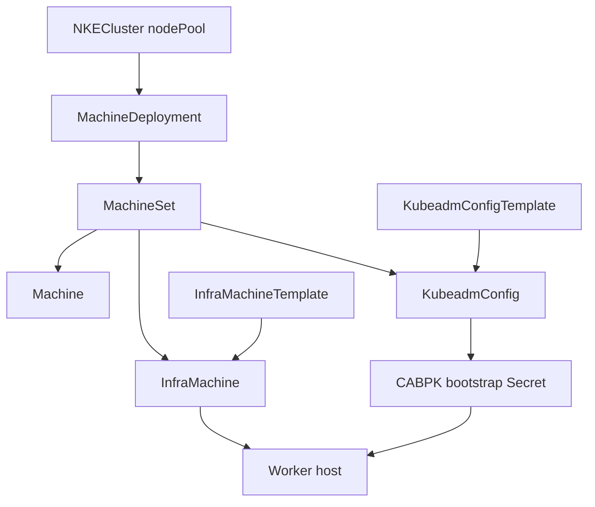
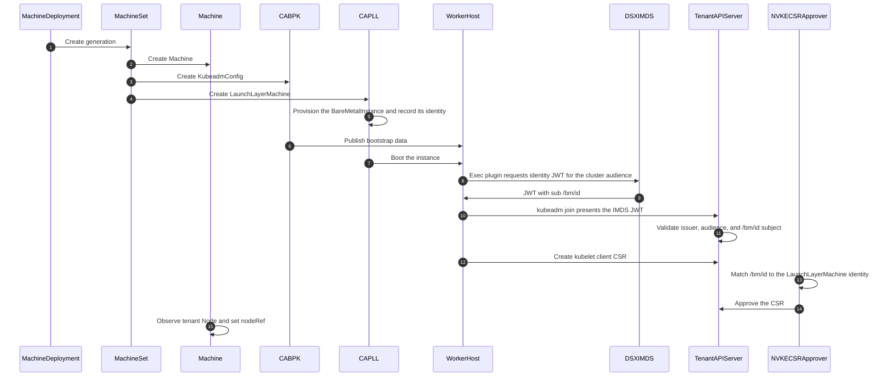
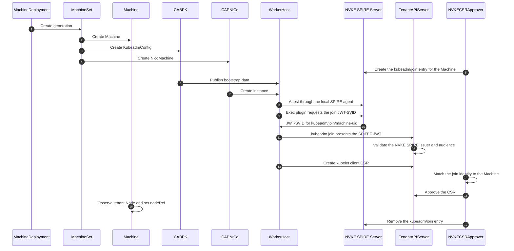

# DSX NVKE Workload Cluster Node Provisioning and Bootstrap: Detailed Design

Author: rbever

## Revision History

| Revision | Date | Notes |
|---|---|---|
| 1.0 | Oct 15, 2026 | Implementation design for the agent-less CABPK worker join. The DSX IMDS identity source and the NVKE SPIRE identity source are both first-class. |
| 1.1 | Oct 16, 2026 | Add the exact per-Machine bootstrap RBAC subject strategy proven in the POC and select it over broad subject-pattern RBAC. |

## Related Designs

- [NVKE CAPI Worker Bootstrap Options and Decision](capi_m3_design_v1.4_a.md)
- [NKE CAPI M3b: Worker MachineDeployments](capi_m3_design_v1.4_b.md)
- [NKE CAPI M1: Infra provider abstraction](https://docs.google.com/document/d/1or0m1obQp6-YUdOr3bXZth64-gssxfsWFT-zFco31yE)
- [NKE CAPI M2: Migration path for Forge](https://docs.google.com/document/d/1svBFv6u7BpFN5TswoWyPc0jhfjIEnWmMYXBbF6Fn_GU)
- [Trey Thomas / spiffe-kubeadm-capi-poc](https://gitlab-master.nvidia.com/treyt/spiffe-kubeadm-capi-poc)
- [[DSX] NKE Workload Clusters SADD](https://docs.google.com/document/d/1dLI8IE3VE6Phy7PYh4fr7yXVc7Qw2mPElruxGsmnCb0/edit?tab=t.bq26oqijm5yh#heading=h.1u62c015ev8o)
- [DSX NVKE Workload Cluster Node Provisioning and Bootstrap](https://docs.google.com/document/d/1RFmZgp2qR9vEJSTQcAkQPRckwcy8zzJQpo65zRER-C4/edit?usp=sharing)

## Overview

This document specifies the NVKE worker join selected in
[NVKE CAPI Worker Bootstrap Options and Decision](capi_m3_design_v1.4_a.md).
Implementation stories come from this document.

The architecture is one agent-less CABPK join with two identity sources:

- **External JWT issuer (DSX IMDS).** The discovery credential is a JWT minted by an
  infrastructure-provided identity service. DSX IMDS is the first concrete
  issuer for this path. It is Option A in the options document.
- **NVKE SPIRE.** The discovery credential is a JWT-SVID from the NVKE SPIRE
  server. This path is for deployments whose infrastructure does not provide a
  tenant-trusted worker identity service. It is Option A.1 in the options
  document.

[DSX NVKE Workload Cluster Node Provisioning and Bootstrap](https://docs.google.com/document/d/1RFmZgp2qR9vEJSTQcAkQPRckwcy8zzJQpo65zRER-C4/edit?usp=sharing)
describes the DSX path and notes that the same direct join can run on the
NVKE-managed SPIRE agent. Both identity sources are specified here because NVKE is the
software those deployments run.

A tenant cluster may need separate JWT authenticators for management access and
worker bootstrap. In the local NVKE/CAPI path, management and CAPI tenant
access use the NVKE SPIRE identity configured for the controller's kubeconfig.
The DSX deployment must confirm whether management access uses NVKE SPIRE, a
DSX identity source, or another issuer. Worker bootstrap may use a different
authenticator, such as DSX IMDS. A worker pool generation still renders
exactly one bootstrap identity source. Its `KubeadmConfigTemplate` must use the
matching discovery exec plugin, and its infrastructure template must create
Machines whose provider identity can be matched by that identity source. The
identity sources share the CABPK object model, worker commands, discovery
authentication, bootstrap RBAC, and serving-certificate handling. They differ
in issuer, subject, infrastructure identity, and how the exec plugin obtains
the JWT.

The agent-based joins, Option B and Option C in the options document, are not
specified here.

Worker lifecycle stays in
[NKE CAPI M3b: Worker MachineDeployments](capi_m3_design_v1.4_b.md):
`NKECluster` to `MachineDeployment` reconciliation, rollout, scale-down,
disruption, health, remediation, teardown, and status. This document keeps
only the bootstrap contract M3b needs:

- a worker generation references one shared `KubeadmConfigTemplate`;
- the template contains no node-specific identity or join credential; and
- per-machine identity comes from the `Machine`, the infrastructure Machine,
  and the identity source's issuer after the Machine exists.

Control-plane nodes stay on the existing NVKE path, including the
control-plane `InstallCNI` that installs the OVN manifests.

## Shared Direct Join

### Object Model



This graph shows the shared CAPI and CABPK objects that exist before a worker
joins. It intentionally omits the identity issuer, tenant API server, and NVKE
CSR approver because those are runtime join participants. The identity-source
sequence diagrams below show how those participants differ between external
JWT and NVKE SPIRE bootstrap.

### Template Contract

- A worker pool generation has one `KubeadmConfigTemplate`.
- Every Machine in that generation uses that template.
- The template may include static files, static commands, and CNI
  prerequisites.
- The template must not include a kubeadm bootstrap token, a bearer discovery
  kubeconfig, a minted JWT, a per-node kubelet certificate, or a command that
  embeds a node-specific join credential.
- The credential that authorizes kubeadm join becomes usable only when the
  exec plugin requests it for this cluster.

### Bootstrap Data

Shared bootstrap data may contain:

- kubelet patches and static host prerequisites;
- the worker `preKubeadmCommands`; and
- CABPK-generated `kubeadm join` configuration and a discovery kubeconfig
  whose user is the identity source's exec plugin.

Before `kubeadm join`, the worker host must have:

- the selected Kubernetes binaries and systemd units installed
- the OVN node images available to containerd
- the selected exec auth plugin available
- `openvswitch-switch` and `configure-openvswitch` available, with
  `configure-openvswitch` run before join

A typical worker release can satisfy those requirements in
`NodePoolRelease.spec.machineInit.userDataTemplate` with cloud-init commands
like this:

```yaml
apiVersion: internal.nvke.nvidia.com/v1
kind: NodePoolRelease
spec:
  machineImageRef:
    name: nvke-nico-vms-24.04-amd64-fde
  machineInit:
    userDataTemplate: |
      #cloud-config
      runcmd:
        - apt-get update
        - DEBIAN_FRONTEND=noninteractive apt-get install -y nvke-kubeadm-distro-<version>
        - DEBIAN_FRONTEND=noninteractive apt-get install -y nvke-cni-ovn-images-<version>

        # DSX IMDS worker releases install the IMDS exec plugin.
        # - DEBIAN_FRONTEND=noninteractive apt-get install -y imds-jwt-exec-auth

        # NVKE SPIRE worker releases install the SPIRE agent and SPIFFE JWT exec plugin.
        # - DEBIAN_FRONTEND=noninteractive apt-get install -y spire-agent k8s-spiffe-workload-jwt-exec-auth

        - configure-openvswitch
```

A production OS image may bake some or all of those artifacts in instead. The
design requirement is the pre-join state, not the package-install mechanism.

`nvke-cni-ovn-images` imports the OVN images that the `ovnkube-node` DaemonSet
runs. Control-plane `InstallCNI` still installs the OVN manifests.
`configure-openvswitch` moves the management interface's DHCP or static address
onto an Open vSwitch bridge.

Shared bootstrap data must not contain:

- a kubeadm bootstrap token;
- a bearer discovery kubeconfig;
- a JWT; or
- a credential that is usable before the exec plugin requests it.

The worker image or bootstrap commands provide `configure-openvswitch` and
`openvswitch-switch`. They do not install or start `nvke-agent`. Each identity
source adds its own exec plugin, and the SPIRE identity source also adds the
SPIRE agent.

CABPK publishes bootstrap data only after the Cluster control plane is
initialized and the CABPK contract exists: Secret `<cluster>-ca` and
`Cluster.spec.controlPlaneEndpoint`. Today, the main NVKE tenant-access
controller publishes per-cluster kubeconfig Secrets. This design extends that
controller to publish the CABPK contract from the admin kubeconfig. The CA
Secret carries the tenant CA certificate and a placeholder key so stock CABPK
can render worker join data.

Cloud-init runs `kubeadm join`. NVKE does not call a node agent to start the
join. This design ends when the node joins the tenant cluster. Any post-join
work that marks the node ready for scheduling, such as clearing the
`nvke.nvidia.com/provisioning` marker, belongs to the worker generation's
`MachineDeployment` controller.

### Discovery Authentication

Both identity sources authenticate with structured authentication. The tenant
apiserver maps the discovery JWT's `sub` claim to the request's Kubernetes
username. The authentication configuration may also add
`nvke:node-bootstrapper` to the user's groups so NVKE can tell that the request
used a worker-bootstrap identity source. The expression differs by identity
source.

For example, a DSX IMDS worker discovery JWT could look like this:

```json
{
  "aud": "my-workload-cluster",
  "iss": "https://imds.dsx.example.com/identity",
  "sub": "spiffe://<operator-tenant>.<region>.dsx.<partition>/bm/<id>"
}
```

An NVKE SPIRE worker discovery JWT could look like this:

```json
{
  "aud": "my-workload-cluster",
  "iss": "https://spire-oidc.nvke.example.com/<nvke-trust-domain>",
  "sub": "spiffe://<nvke-trust-domain>/kubeadm/join/<machine-uid>"
}
```

After the tenant apiserver accepts the JWT, it builds Kubernetes user info for
the request. That user info has a `username` and a list of `groups`, just like a
normal Kubernetes client certificate or service account token. The structured
authentication config below uses the JWT `sub` claim as the `username`. Its CEL
expression adds the bootstrap group only when the subject has the shape this
identity source owns, such as `/bm/<id>` for IMDS or
`/kubeadm/join/<machine-uid>` for NVKE SPIRE:

```yaml
claimMappings:
  username:
    claim: sub
    prefix: ""
  groups:
    expression: "<subject match> ? ['nvke:node-bootstrapper'] : []"
```

For the two identity sources, the group expressions have this shape:

```yaml
# DSX IMDS
expression: "claims.sub.matches('^spiffe://[^/]+/bm/[^/]+') ? ['nvke:node-bootstrapper'] : []"

# NVKE SPIRE
expression: "claims.sub.matches('^spiffe://[^/]+/kubeadm/join/.+') ? ['nvke:node-bootstrapper'] : []"
```

`matches()` is a Common Expression Language (CEL) string function. The regular
expression checks the shape of the JWT subject. `^spiffe://` anchors the match
at the beginning of the subject, `[^/]+` means "one path segment," and the
literal path identifies the identity source: `/bm/` for DSX IMDS or
`/kubeadm/join/` for NVKE SPIRE. If the subject matches, the expression returns
the bootstrap group. If it does not match, it returns no groups.

### Bootstrap RBAC Subject Strategy

There are two viable ways to grant the join-time RBAC permissions that kubeadm
needs after the tenant apiserver authenticates the discovery JWT.

**Subject-pattern group RBAC.** Structured authentication maps every subject
with the expected shape into `nvke:node-bootstrapper`, and RBAC binds that
group to the join-time permissions. A simplified binding to the
`system:node-bootstrapper` ClusterRole looks like this:

```yaml
subjects:
  - kind: Group
    name: nvke:node-bootstrapper
roleRef:
  kind: ClusterRole
  name: system:node-bootstrapper
```

Group `nvke:node-bootstrapper` gets the join-time permissions kubeadm otherwise
grants to `system:bootstrappers:kubeadm:default-node-token`:

- bind to `system:node-bootstrapper` so the kubelet can create its client CSR
- bind to `kubeadm:get-nodes` so kubeadm can read Node information
- bind to `kubeadm:nodes-kubeadm-config` in `kube-system` so kubeadm can read the node and kubeadm config needed during join
- bind to `kubeadm:kubelet-config` in `kube-system` so kubeadm can read the kubelet config needed during join

Those bindings let kubeadm submit the kubelet client CSR and read the config it
needs during join. They do not approve the CSR or grant broad tenant access.
Approval is a separate decision by NVKE. This strategy is simple, but every
subject that matches the configured CEL pattern receives the same discovery
RBAC until the CSR approver rejects or accepts the CSR.

**Exact per-Machine User RBAC.** NVKE adds the exact authenticated
username for each joining Machine to the bootstrap RBAC bindings, then removes
that subject after CAPI observes `Machine.status.nodeRef`. The tenant apiserver
still authenticates the JWT and may still add `nvke:node-bootstrapper` as a
classification signal for the CSR approver, but RBAC is granted to concrete
User subjects, not to every subject that matches a pattern.

For an NVKE SPIRE worker, the temporary subject is:

```text
spiffe://<trust-domain>/kubeadm/join/<machine-uid>
```

For a DSX IMDS worker, the temporary subject is:

```text
spiffe://<operator-tenant>.<region>.dsx.<partition>/bm/<id>
```

The POC proved exact per-Machine User RBAC with CABPK and NVKE SPIRE. A worker
joined with an exact User subject in tenant RBAC, the kubelet client CSR was
approved for that exact SPIFFE subject, and NVKE removed the subject after the
Machine got `nodeRef`. Implement exact per-Machine User RBAC unless scale
testing shows that frequent subject-list updates are a problem. Keep
subject-pattern group RBAC as the fallback because it avoids per-Machine RBAC
writes at the cost of broader bootstrap authorization.

### Client CSR Approval

Authentication of the discovery JWT and exact bootstrap RBAC are not approval
of the kubelet client CSR. The NVKE tenant CSR approver checks the
authenticated username and, if configured, the bootstrap classification group,
then checks the subject against the expected Machine.

It skips the CSR when:

- the authenticated Kubernetes username, derived from the JWT `sub` claim, does not match the identity source's subject
- the groups omit `nvke:node-bootstrapper`, when the CSR approver is configured
  to require that classification group
- the identity does not match exactly one Machine
- the Machine is a control-plane Machine
- the Machine is deleting
- the Machine already has `status.nodeRef`

When it skips, the controller logs the reason and leaves the CSR status
unchanged. It does not add an `Approved`, `Denied`, or `Failed` condition.

### Serving CSR Approval

Serving CSR approval is post-join. It is not required for `kubeadm join` to
complete, and the MachineDeployment controller owns the post-join work that
makes the CAPI Machine observe the tenant Node. This design calls it out
because the CAPI worker path should use the CAPI Machine as the source of
truth, not the legacy NVKE node-row lookup. The serving CSR approver must
requeue until `Machine.status.nodeRef` is set, then validate the serving SANs
against the joined Node.

## DSX IMDS Identity Source

DSX workload cluster workers use this identity source. The canonical DSX
infrastructure provider is CAPLL, whose worker kinds are `LaunchLayerMachine`
and `LaunchLayerMachineTemplate`.

The discovery kubeconfig uses a Kubernetes exec credential plugin named
`imds-jwt-exec-auth`. When kubeadm performs discovery, client-go invokes the
plugin. The plugin reads
`GET /latest/meta-data/identity?aud=<cluster-name>` from the host IMDS and
returns the JWT as a bearer token.

The JWT subject is
`spiffe://<operator-tenant>.<region>.dsx.<partition>/bm/<id>`. IMDS chooses
`<id>`. The plugin does not. For a DSX workload cluster worker, `<id>` is
`BareMetalInstance.spec.instance_id`. The CSR approver accepts the kubelet
client CSR only when that value identifies the LaunchLayerMachine owned by
the joining Machine. CAPLL must expose that identity on the
LaunchLayerMachine. The approver reads it there and follows the owner
reference to the CAPI Machine. It does not read a SPIRE entry.



The join credential is not in user data. IMDS mints it when the exec plugin
asks, and the token audience is the cluster name. Any process on the host can
ask IMDS for a token, so possession of an IMDS token is not enough to become a
Node. The token must have the worker's `/bm/<id>` subject, tenant RBAC must
grant join-time permissions to that exact subject, and the NVKE tenant CSR
approver must confirm that `/bm/<id>` belongs to exactly one worker Machine
before it approves the kubelet client CSR.

| Identity | Purpose |
|---|---|
| `spiffe://<operator-tenant>.<region>.dsx.<partition>/bm/<id>` | Audience-bound discovery identity. The username is the full subject. |

A compact ES256 JWT payload has this shape. These values are placeholders:

```json
{
  "aud": "my-workload-cluster",
  "exp": 1791925500,
  "iat": 1791925200,
  "iss": "https://imds.dsx.example.com/identity",
  "sub": "spiffe://<operator-tenant>.<region>.dsx.<partition>/bm/<id>"
}
```

`aud` is the CAPI cluster name. `my-workload-cluster` is only the example value
above. `iat` and `exp` are ordinary JWT timestamps set by the DSX identity
issuer. The subject is SPIFFE-shaped, but NVKE SPIRE does not issue it. This
identity source does not create a `kubeadm/join/<machine-uid>` entry.

As described in [Discovery Authentication](#discovery-authentication), the tenant apiserver needs
configuration before it can trust an IMDS JWT. NVKE renders that configuration,
but DSX owns the issuer. DSX supplies those values as NVKE controller
deployment configuration:

- `WORKER_BOOTSTRAP_IDENTITY_SOURCE=imds` selects the IMDS worker bootstrap path
- `WORKER_BOOTSTRAP_IMDS_ISSUER_URL` is the expected JWT `iss` value
- `WORKER_BOOTSTRAP_IMDS_DISCOVERY_URL` is the issuer discovery or JWKS endpoint
- `WORKER_BOOTSTRAP_IMDS_DISCOVERY_CA` verifies that HTTPS endpoint
- `WORKER_BOOTSTRAP_IMDS_OPERATOR_TENANT` constrains the accepted subject prefix

The accepted `aud` value is the CAPI cluster name. Token lifetime comes from
the JWT `iat` and `exp` claims.

With that configuration, the tenant apiserver can verify that the JWT was
signed by the IMDS issuer, was minted for this cluster, and has not expired.
The IMDS subject must also start with `spiffe://<operator-tenant>.`.

Client CSR approval requires the BareMetalInstance identity on the
LaunchLayerMachine owned by the joining worker Machine to equal the
`/bm/<id>` segment.

DSX Identity defines the tenant-facing `BareMetalInstance` subject as
`/bm/<spec.instance_id>`. CAPLL must preserve that identity on the
LaunchLayerMachine so NVKE can bind the authenticated subject to exactly one
CAPI Machine.

## NVKE SPIRE Identity Source

This identity source is the same CABPK join for workers whose infrastructure has
no native identity that Kubernetes structured authentication can trust directly.
The canonical NVKE infrastructure provider is CAPNICo, whose infrastructure
references are `NicoCluster` and `NicoMachineTemplate`.

The discovery kubeconfig uses the SPIFFE JWT exec credential plugin,
`k8s-spiffe-workload-jwt-exec-auth`. When kubeadm performs discovery, client-go
invokes the plugin. The plugin asks the local SPIRE agent for a JWT-SVID using
the tenant cluster name as the audience and `kubeadm-join` as the workload hint.
The NVKE SPIRE server issues that JWT-SVID only after the SPIRE agent attests
and the temporary join entry authorizes that workload.



The join credential is not in user data. NVKE creates a temporary
`kubeadm/join/<machine-uid>` entry for the Machine before the worker boots and
removes it after CAPI observes `status.nodeRef`. The SPIRE server issues the
JWT-SVID only if the agent attests and the exec plugin workload matches that
join entry.

| Identity | Purpose |
|---|---|
| `spiffe://<trust-domain>/kubeadm/join/<machine-uid>` | Short-lived kubeadm discovery identity used only by the exec plugin. |

There is no host SVID. Nothing on the worker presents one. The SPIRE agent
attests only so the server can issue this JWT.

Client CSR approval uses the join SPIFFE ID itself as the Machine reference.
NVKE created `kubeadm/join/<machine-uid>` for one Machine, so the approver
checks that the CSR username has that subject and that the referenced Machine
is the expected worker Machine. Unlike the IMDS path, it does not translate a
provider instance identity such as `/bm/<id>` back to an infrastructure
Machine.

### Workload Selection

The join entry must match the exec plugin process, not every root process on
the worker. That scoping matters even when the worker has no separate host
SVID. The hint makes the kubeadm discovery plugin select this join JWT-SVID
when other SPIRE entries, such as a future host or agent SVID, also exist. The
selector is the exec plugin path, and the hint is `kubeadm-join`:

- selector: `unix:path:/opt/spiffe/bin/k8s-spiffe-workload-jwt-exec-auth`
- `spec.hint`: `kubeadm-join`

The discovery kubeconfig sets `SPIFFE_JWT_HINT` to that hint so the plugin
selects this JWT-SVID.

Path selectors require SPIRE's unix workload attestor to discover the
workload path:

```hcl
WorkloadAttestor "unix" {
    plugin_data {
        discover_workload_path = true
    }
}
```

On Ubuntu, the packaged SPIRE agent runs as a non-root service user. Path
discovery still has to read `/proc/<pid>/exe` for the root-owned plugin.
Without that, SPIRE returns empty selectors. The agent unit therefore needs
`AmbientCapabilities=CAP_SYS_PTRACE` before `spire-agent` starts.

### Tenant Authentication

As described in [Discovery Authentication](#discovery-authentication), this
identity source extends the tenant apiserver's existing NVKE SPIRE structured
authentication. It does not add a separate authenticator. The group expression
matches the `/kubeadm/join/<machine-uid>` subject shape for CSR-approver
classification, while the selected RBAC strategy grants join-time permissions
to exact per-Machine User subjects.

### Node Provider ID

NVKE publishes `<cluster>-kubeconfig` as a SPIRE exec plugin
(`/opt/spiffe/bin/k8s-spiffe-workload-jwt-exec-auth`). CAPNICo
`reconcileNodeProviderID` refuses that Secret because the workload kubeconfig
uses an exec credential plugin. CAPI core, CABPK, and kubeadm control plane
already mount that plugin and the SPIRE socket from
`controller/deploy/k8s/capi-spiffe-exec-auth/`. NVKE's `nico-provider-id`
controller already patches `Node.spec.providerID`. Implementation must choose
one provider-ID ownership model:

- NVKE owns provider ID reconciliation. It sets
  `nico.nvidia.com/skip-node-provider-id-reconciliation: "true"` on each
  CAPNICo-backed CAPI `Cluster` it owns. CAPNICo already documents that
  annotation as the opt-out when another controller owns the Node provider ID.
- CAPNICo owns provider ID reconciliation. It accepts the exec kubeconfig and is
  deployed with the same SPIFFE exec-auth mount CAPI core already has. The
  allowed command stays the pinned plugin.

## Controller Responsibilities

| Responsibility | Common behavior | DSX IMDS identity source | NVKE SPIRE identity source |
|---|---|---|---|
| Render bootstrap data | CABPK renders from `KubeadmConfigTemplate` with no static join credential. | Discovery kubeconfig uses the `imds-jwt-exec-auth` exec credential plugin. | Discovery kubeconfig uses the SPIFFE JWT exec credential plugin. |
| Start kubeadm | Cloud-init runs `kubeadm join` on the host. | Same. | Same. |
| Publish CABPK contract | Tenant-access publishes `<cluster>-ca` and `Cluster.spec.controlPlaneEndpoint` before worker bootstrap data. | Same. | Same. |
| Create the discovery credential | The exec plugin requests a JWT at join time. | IMDS mints a JWT with the worker `/bm/<id>` subject and cluster audience. | NVKE creates a temporary `kubeadm/join/<machine-uid>` entry, SPIRE issues that JWT-SVID, and NVKE removes the entry after `nodeRef`. |
| Tenant authentication and RBAC | Structured authentication maps the JWT subject to the Kubernetes username. Exact per-Machine User RBAC grants kubeadm join-time permissions and is removed after `nodeRef`. | Structured authentication trusts the IMDS issuer. The exact RBAC subject is the full SPIFFE-shaped username with the `/bm/<id>` path. | Existing NVKE SPIRE structured authentication is extended. The exact RBAC subject is the full SPIFFE ID with the `kubeadm/join/<machine-uid>` path. |
| Kubelet client CSR | NVKE skips unless authenticated username, group, and Machine checks pass. | `/bm/<id>` maps to the BareMetalInstance identity on exactly one worker `LaunchLayerMachine`. | `kubeadm/join/<machine-uid>` maps directly to the expected worker Machine. |
| Kubelet serving CSR | Post-join. Requeue until `Machine.status.nodeRef` is set, then validate SANs. | Same. | Same. |

## Implementation Stories

The POC has proven both identity sources with CABPK and no node-agent driven
join. The implementation epic can split into focused stories that keep the
shared contract stable while allowing DSX IMDS and NVKE SPIRE to progress in
parallel.

### Story 1: Shared CABPK Worker Join Foundation

Goal: define the reusable agent-less CABPK bootstrap contract for worker
Machines.

Work items:

- Define the shared worker `KubeadmConfigTemplate` content.
- Publish the CABPK prerequisites before worker bootstrap data is requested:
  `<cluster>-ca` and `Cluster.spec.controlPlaneEndpoint`.
- Upstream the CABPK change that allows worker joins to use a certificate-only
  cluster CA Secret, so NVKE does not need a placeholder `tls.key`.
- Define the shared pre-join host requirements: selected Kubernetes binaries,
  OVN node images, `openvswitch-switch`, and `configure-openvswitch`.
- Harden and ship `configure-openvswitch` as the canonical OVN host prerequisite.
  It must wait for DHCP and the default route to settle after `netplan apply`,
  repair partial OVS/netplan states instead of treating bridge existence as
  success, remain safe to rerun before or after kubeadm join, and flush
  persistent network config before returning.
- Ensure the worker image or a versioned node artifact contains
  `configure-openvswitch` and `openvswitch-switch`.
- Ensure agent-less worker images do not install or start `nvke-agent`.
- Keep the bootstrap data free of kubeadm bootstrap tokens, bearer discovery
  kubeconfigs, JWTs, and node-specific join credentials.

Acceptance criteria:

- The shared worker bootstrap contract contains no reusable join credential.
- Cloud-init owns `kubeadm join`; NVKE does not call a node agent to join the
  node.
- The bootstrap contract can be reused by all Machines that use the same worker
  template.
- `configure-openvswitch` does not return until the default route is on the OVS
  bridge, or until it fails clearly before kubeadm join can proceed.
- Re-running `configure-openvswitch` repairs the known post-join partial state:
  OVS owns the physical uplink, but live L3 or persistent netplan still points at
  the physical interface.

### Story 2: Shared Tenant Bootstrap Authorization

Goal: add the tenant-side authorization surface that both identity sources use.

Work items:

- Render the shared bootstrap RBAC bindings for kubeadm discovery and kubelet
  client CSR creation.
- Implement exact per-Machine User subject management for those bindings:
  add the expected bootstrap username while the Machine has no `nodeRef`, and
  remove it after CAPI observes `Machine.status.nodeRef`.
- Keep the subject-list patching concurrency safe. A reconcile must not
  silently overwrite another controller's subject-list update.
- Render structured authentication for the selected worker bootstrap identity
  source.
- Refactor the client CSR approver to share the common checks: username,
  group, single Machine match, worker-only, not deleting, and no existing
  `nodeRef`.

Acceptance criteria:

- The tenant grants kubeadm bootstrap permissions only to exact per-Machine
  User subjects for Machines that have not joined yet.
- The exact bootstrap subject is removed from tenant RBAC after the Machine
  gets `nodeRef`.
- A CSR with bootstrap RBAC but the wrong worker identity is not approved.

### Story 3: DSX IMDS Identity Source

Goal: enable the DSX workload-cluster path where the discovery credential comes
from DSX IMDS.

Work items:

- Create `imds-jwt-exec-auth` as a real Go module and versioned binary
  artifact.
- Add the IMDS discovery kubeconfig user that invokes `imds-jwt-exec-auth`.
- Render the IMDS structured authenticator with the tenant cluster audience,
  issuer, CA bundle, and `/bm/<id>` group expression.
- Ensure CAPLL exposes the tenant-facing BareMetalInstance identity on the
  `LaunchLayerMachine`.
- Match client CSRs by resolving `/bm/<id>` to the `LaunchLayerMachine` owned
  by the joining CAPI Machine.
- Add focused tests for the IMDS authenticator and CSR matching behavior.

Acceptance criteria:

- A DSX IMDS worker joins through CABPK without a kubeadm bootstrap token.
- The tenant apiserver authenticates the IMDS JWT and the bootstrap RBAC grants
  join-time permissions only to the exact expected `/bm/<id>` subject.
- NVKE approves the kubelet client CSR only when `/bm/<id>` matches the
  expected worker Machine.

### Story 4: NVKE SPIRE Identity Source

Goal: enable the open source NVKE and Forge fleet path where the discovery
credential comes from NVKE SPIRE.

Work items:

- Install and configure `spire-agent` on the worker image or bootstrap path.
- Install the SPIFFE JWT exec plugin at
  `/opt/spiffe/bin/k8s-spiffe-workload-jwt-exec-auth`.
- Configure the discovery kubeconfig with the host-side SPIRE socket path
  `unix:///tmp/spire-agent/public/api.sock`, the tenant cluster audience, and
  `SPIFFE_JWT_HINT=kubeadm-join`.
- Publish the SPIRE initial trust bundle as a Kubernetes Secret consumed by
  CABPK `contentFrom.secret`. Bootstrap commands must not overwrite that file
  with an env-substituted or stale bundle.
- Enable unix workload path discovery and grant the SPIRE agent
  `CAP_SYS_PTRACE` so it can resolve the root-owned exec plugin path.
- Create a temporary per-Machine `ClusterStaticEntry` whose parent is the
  TPM-attested agent identity and whose SPIFFE ID is
  `spiffe://<trust-domain>/kubeadm/join/<machine-uid>`.
- Include temporary join entries in the TPM pubhash allowlist so TPM
  attestation succeeds before the worker has joined.
- Remove the join entry after CAPI observes `Machine.status.nodeRef`.
- Match client CSRs by resolving `kubeadm/join/<machine-uid>` to the expected
  CAPI Machine.
- Decide and implement the CAPNICo provider ID behavior: NVKE-owned provider ID
  patching with CAPNICo opt-out, or CAPNICo support for the SPIFFE exec
  kubeconfig.

Acceptance criteria:

- An NVKE SPIRE worker joins through CABPK without a kubeadm bootstrap token.
- The SPIFFE exec plugin receives only the join JWT-SVID selected by
  `kubeadm-join`.
- The SPIRE agent starts with the current trust bundle and opens its workload
  API socket before kubeadm join starts.
- NVKE approves the kubelet client CSR only when the join identity matches the
  expected worker Machine.
- The temporary join `ClusterStaticEntry` is removed after `nodeRef` is set.
