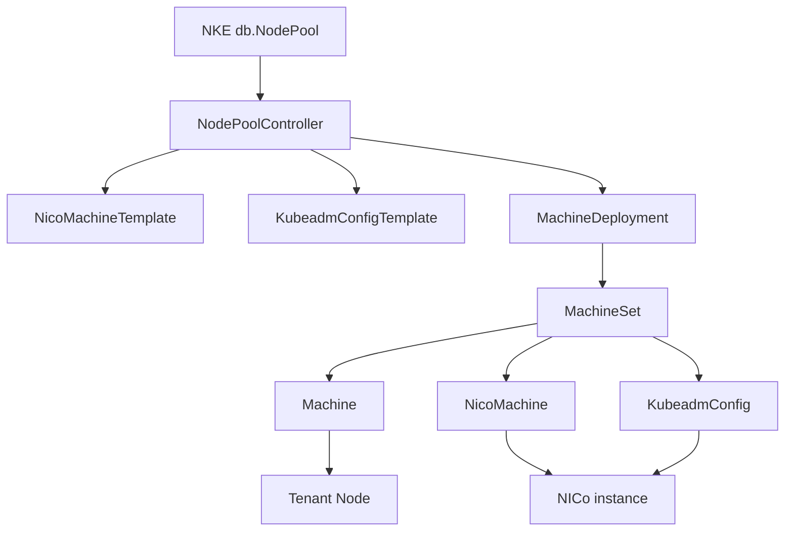
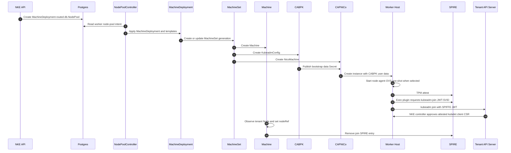
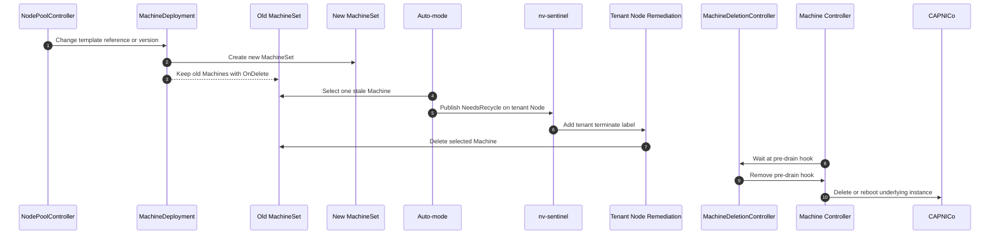

# NKE CAPI M3: Worker MachineDeployments

Author: rbever

## Revision History

| Revision | Date | Notes |
|---|---|---|
| 1.0 | Sep 22, 2026 | Worker MachineDeployment design using SPIFFE JWT-SVID kubeadm join |

## Stakeholders

| Stakeholder | Relation to Project | Date Accepted |
|---|---|---|
| Mike Moore | NKE manager | |
| Kishore Karthikeyan | NKE architect | |

## Related Designs

- [NKE CAPI M1: Infra provider abstraction](https://docs.google.com/document/d/1or0m1obQp6-YUdOr3bXZth64-gssxfsWFT-zFco31yE)
- [NKE CAPI M2: Migration path for Forge](https://docs.google.com/document/d/1svBFv6u7BpFN5TswoWyPc0jhfjIEnWmMYXBbF6Fn_GU)
- [Trey Thomas / spiffe-kubeadm-capi-poc](https://gitlab-master.nvidia.com/treyt/spiffe-kubeadm-capi-poc)

## Overview

This proposal moves NKE **worker** node pools to a CAPI-native worker lifecycle built on
`MachineDeployment`, `MachineSet`, `Machine`, stock CABPK, and CAPI infrastructure
providers.

This document uses `InfraMachine` and `InfraMachineTemplate` as conceptual names for
the provider-specific infrastructure kinds. CAPNICo is the canonical example used
throughout, so those names correspond to `NicoMachine` and `NicoMachineTemplate` in the
examples. Any conforming infrastructure provider may be used instead; for example,
LaunchLayer supplies `LaunchLayerMachine` and `LaunchLayerMachineTemplate`.

For worker node pools, the NKE API remains the user-facing contract. A user still creates
and updates `/nodePools`; NKE translates that desired state into CAPI resources behind
the API. The runtime source of truth for workers moves out of Postgres and into the
management-cluster Kubernetes API.

Each `db.NodePool` persists its lifecycle owner. Legacy pools remain on the Postgres
and Temporal path until a migration controller records a completed handoff;
MachineDeployment pools are reconciled by the MachineDeployment path in
`NodePoolController`. The site-controller deployment uses
`MACHINE_DEPLOYMENT_WORKERS_ENABLED` to default new worker node pools to
MachineDeployment ownership and to permit migration. Disabling the gate stops new
handoffs but does not change ownership already persisted on a pool.

The target worker shape is:

- one `MachineDeployment` per worker node pool;
- CAPI-owned `MachineSet` generations under that deployment;
- CAPI-owned `Machine` and `InfraMachine` objects for individual workers;
- one shared `KubeadmConfigTemplate` per bootstrap generation;
- one shared `InfraMachineTemplate` per infrastructure generation;
- no worker `db.Node` rows;
- no worker `db.NodeSet` rows;
- no worker Temporal workflows; and
- no per-pool configuration profile selection or execution.

The public OpenAPI `configProfile` node-pool field is deprecated. It remains only so
legacy-routed worker node pools and the existing control-plane behavior can be represented
during migration. A request that creates or converts a MachineDeployment-routed worker
pool must not select `configProfile`; the API rejects that combination. Deprecation is
recorded in the OpenAPI source and propagated to generated API models and documentation
through the owning repository's normal generation path.

Control-plane nodes do not move in this milestone. They remain on the current
NKE-owned control-plane path, where the node agent runs `kubeadm init` or
`kubeadm join --control-plane --certificate-key`. That split is intentional. Worker
joins and control-plane joins have different PKI, quorum, and lifecycle requirements.

The join credential for MachineDeployment workers is a SPIFFE JWT-SVID minted on the
host after SPIRE attestation. CABPK renders the worker `kubeadm join` flow, but its
discovery kubeconfig uses an exec credential plugin. Kubeadm invokes that plugin, the
plugin asks the local SPIRE Workload API for a JWT-SVID, and the tenant apiserver
authenticates that JWT through Kubernetes structured JWT authentication.

This design applies an NKE disruption-authorization lifecycle hook to every worker
Machine. When a Machine is selected for scale-down, recycle, repair, or stale-generation
replacement, CAPI pauses at pre-drain until NKE or nv-sentinel authorizes disruption.
That pre-drain hook is the only deletion gate in this design.

## Context

CAPI M1 introduced a provider-agnostic CAPI infrastructure boundary. CAPI M2 introduced
CAPNICo and moved Forge/NICo infrastructure lifecycle behind CAPI `Cluster` and
`Machine` objects while preserving NKE's existing node orchestration model.

That leaves worker node pools in an awkward middle state. CAPI can create infrastructure,
but NKE still creates one worker `Machine` per Postgres `db.Node`, drives kubeadm
through Temporal and the node agent, and stores worker runtime state in Postgres. This
means NKE owns scheduling, rollout, teardown, health, and history behavior that CAPI
already models for homogeneous worker node pools.

The worker node pool case fits CAPI well. Workers are many interchangeable nodes behind a
pool-level desired count. Template changes should create a new generation without
immediately disrupting GPU workloads. Scale-up should be CAPI's job. Scale-down,
recycle, and repair must still respect NKE's disruption policy and nv-sentinel.

Stock CABPK is sufficient to render and drive worker joins without placing a kubeadm
bootstrap token in instance user data or having CWE mint a token later. NKE configures
CABPK file discovery with an exec credential plugin. The host mints the join credential
from SPIRE only after the `Machine` and `InfraMachine` identity have attested.

Migration cannot be an instantaneous removal of the old path. A separate migration
controller must convert existing Postgres-backed workers through an explicit,
idempotent state machine without creating duplicate capacity, then persist the
MachineDeployment owner only after the handoff is safe. New MachineDeployment pools
use the CAPI path directly and do not use configuration profiles. Worker Temporal
workflows are removed after every legacy pool has completed migration.

## Goals and Non-Goals

Goals:

- Use stock CABPK for MachineDeployment worker joins.
- Use one `MachineDeployment` per new or converted NKE worker node pool.
- Keep `/nodePools`, `/nodeSets`, `/nodes`, and related NKE APIs as the product-facing
  surface while using CAPI resources internally.
- Remove worker `db.Node` and `db.NodeSet` runtime state from the target worker path.
- Persist the lifecycle owner for each worker node pool so legacy and MachineDeployment
  pools can coexist during rollout.
- Remove worker Temporal workflows after the last legacy worker node pool is migrated.
- Deprecate the public `configProfile` field and reject it for MachineDeployment pools.
- Preserve NKE's GPU disruption policy and nv-sentinel authorization for scale-down
  and rollout.
- Use tenant structured JWT authentication for worker joins, with SPIFFE JWT-SVIDs
  available only after host attestation and no kubeadm bootstrap tokens or bearer
  credentials in bootstrap data.
- Keep NKE-specific SPIRE and node lifecycle policy outside CABPK.
- Leave optional provisioning taints and MachineConfiguration behavior to their
  dedicated owner rather than the MachineDeployment worker path.

Non-goals:

- Move control-plane nodes to CABPK or KubeadmControlPlane.
- Remove legacy worker Temporal workflows before all legacy pools are migrated.
- Continue allowing SPIRE node bootstrap with SPIRE join tokens for
  MachineDeployment workers.
- Adopt CAPI `MachineHealthCheck` as the NKE remediator.
- Use CAPI `RollingUpdate` for GPU worker rollouts.
- Design in-place mutation of already running workers.
- Design a new public CAPI-native `/machines` API.
- Execute profile runbooks or profile-driven host configuration for
  MachineDeployment workers.

## Milestones

| Milestone | Description |
|---|---|
| Worker CABPK validation | Prove stock CABPK can join an NKE worker with SPIFFE JWT auth and no kubeadm bootstrap token. |
| Direct nico-vms MachineDeployment POC | Hand-apply a one-replica `MachineDeployment` with `NicoMachineTemplate` and `KubeadmConfigTemplate` against a control-plane-only nico-vms tenant before product API routing exists. |
| Worker lifecycle routing | Persist per-pool ownership and use the site gate to default new worker node pools to MachineDeployment ownership and permit migration. |
| Worker MachineDeployment implementation | Create new worker node pools as one `MachineDeployment` per pool, with no configuration profile. |
| Legacy adoption | Add a separate restart-safe migration controller that converts existing pools without duplicate workers and records the ownership handoff. |
| Legacy worker-path removal | After every pool has completed migration, remove legacy worker Temporal activities and workflows, legacy worker database runtime state, and deprecated `configProfile` field. |

This document defines the staged transition to the worker MachineDeployment model:
validate CABPK, add durable routing, implement the new worker path, migrate existing
worker node pools, and only then remove the unused legacy worker path.

## Existing Solution

Today, the worker path still uses the legacy NKE ownership model even when CAPI creates
the underlying infrastructure.

At a high level:

1. The NKE API creates a `db.NodePool`.
2. NKE creates `db.NodeSet` rows and worker `db.Node` rows to represent desired
   workers.
3. The outbox starts Temporal workflows.
4. Temporal activities create per-node CAPI `Machine`, bootstrap, and infrastructure
   objects.
5. The node agent performs host preparation and runs kubeadm.
6. Temporal tracks join, recycle, and teardown progress.

This model worked as an incremental bridge for CAPI M1 and CAPI M2. It is not the
target CAPI shape for workers:

- worker nodes are represented twice, in Postgres and in Kubernetes;
- CAPI cannot own worker generations through `MachineSet`;
- worker rollouts do not use CAPI's `UpToDate` conditions or generation model;
- worker scale-up and scale-down remain tied to Temporal workflows;
- APIs and controllers still read worker truth from Postgres even when CAPI already has
  the authoritative `Machine`; and
- lifecycle work is mixed into workflow phases rather than attached to CAPI Machines.

There is no current worker MachineDeployment path in the controller tree. The existing
CAPI bridge creates one CAPI `Machine` per Postgres worker row and still completes join
through Temporal and node-agent. The first implementation proof therefore cannot start
by refining an existing MachineDeployment controller; it must first validate stock CABPK
and SPIFFE JWT worker join with a directly applied MachineDeployment graph.

## Proposed Solution

### Worker Lifecycle Cutover

`db.NodePool.lifecycle_mode` is the authoritative worker owner:

- **legacy**: the existing node-pool, node-set, scheduler, monitor, auto-mode, and
  Temporal paths own the pool;
- **machineDeployment**: those legacy paths are fenced for the pool, and
  the MachineDeployment reconciler selected by `NodePoolController` owns its templates,
  MachineDeployment, steady-state reconciliation, and deletion.

`MACHINE_DEPLOYMENT_WORKERS_ENABLED` is an admission and rollout gate. While disabled,
new worker node pools default to legacy ownership and migration does not start. While
enabled, new worker node pools default to MachineDeployment ownership and the migration
controller may hand off eligible legacy pools. Changing the gate never rewrites a
pool's persisted owner, so disabling it does not return migrated pools to legacy
controllers.

The migration controller keeps adoption as an explicit state machine rather than
scattering adoption checks through ordinary worker node-pool reconciliation. It derives
progress from legacy `db.NodeSet` and `db.Node` state plus management-cluster
MachineDeployments, MachineSets, and Machines. NodePool conditions report blocked,
progressing, and failed migration. Migration is bounded so enabling a site does not
replace every pool concurrently.

Before enabling the gate on an existing site, an eligibility check must reject pools
that still select `configProfile` or otherwise cannot be converted. Once enabled, the
migration controller must handle partially migrated pools and pools deleted during
conversion idempotently. The MachineDeployment reconciler in `NodePoolController`
handles greenfield and handed-off MachineDeployment pools only.

#### Alternative: one-way site ownership cutover

The alternative is a one-way site-level ownership cutover. Enabling the gate would
fence all legacy worker controllers and make the MachineDeployment reconciler in
`NodePoolController` responsible
for greenfield creation, migration, steady-state reconciliation, and deletion for
every worker node pool. That avoids a temporary per-pool routing field and coordination
between migration and steady-state reconcilers, but makes rollback unsupported and
requires every pool at a site to become eligible at once. The selected persisted-owner
design accepts temporary routing and handoff state so untouched pools remain on their
proven legacy lifecycle and rollout can proceed per pool.

### Worker Node Pool Object Graph

An NKE MachineDeployment worker node pool becomes a thin product API around a CAPI
worker graph. `db.NodePool` remains the durable NKE API record for user intent. It
carries the pool's desired count, Kubernetes version, infrastructure input, lifecycle
selection, and NKE policy fields. It does not fan out into `db.NodeSet` or worker
`db.Node` rows.

The MachineDeployment reconciler in `NodePoolController` translates that row into:

- an `InfraMachineTemplate` whose name includes a short hash of its desired spec;
- a `KubeadmConfigTemplate` whose name includes a short hash of its desired spec;
- a `MachineDeployment` whose `spec.replicas` matches the NKE node pool desired count;
- an `OnDelete` rollout strategy;
- the NKE disruption-authorization lifecycle hook.

There is no configuration-profile label, hash, condition, readiness gate, generated
taint, or configuration controller dependency in this object graph.

The spec-hash naming is the rollover mechanism. CAPI rollouts are driven by template
reference changes. NKE treats each `InfraMachineTemplate` spec as immutable; CAPNICo
also enforces this for `NicoMachineTemplate.spec.template.spec`. Treating the bootstrap
template the same way keeps infrastructure and bootstrap generations aligned: a change
to either input creates a new template name, and updating the `MachineDeployment` to
point at that template causes CAPI to create a new `MachineSet` generation. A
replica-count-only change does not create new templates.

CAPI creates and owns `MachineSet` generations. Each `MachineSet` creates the per-node
`Machine`, `InfraMachine`, and `KubeadmConfig` objects. In the canonical example,
CAPNICo creates the `NicoMachine` and NICo instance and injects the CABPK-rendered
bootstrap data.



Worker identity in the NKE API is the CAPI `Machine` UID. `/nodes` and `/nodes/{id}`
project Machine-backed workers into the existing API shape during the transition.
Delete-by-node-id resolves to a `Machine` delete for MachineDeployment workers.

### Bootstrap and Worker Join

NKE uses stock CABPK for worker joins, but not CABPK's default token discovery. The
shared `KubeadmConfigTemplate` declares file discovery and asks CABPK to render the
file's kubeconfig contents. The kubeconfig has the tenant API endpoint and CA data, but
its user credential is an exec plugin, not a token:

```yaml
joinConfiguration:
  discovery:
    file:
      kubeConfigPath: /run/nke/capi-discovery-kubeconfig
      kubeConfig:
        user:
          exec:
            apiVersion: client.authentication.k8s.io/v1
            command: /opt/spiffe/bin/k8s-spiffe-workload-jwt-exec-auth
            env:
              - name: SPIFFE_ENDPOINT_SOCKET
                value: unix:///tmp/spire-agent/public/api.sock
              - name: SPIFFE_JWT_AUDIENCE
                value: <tenant-cluster-name>
              - name: SPIFFE_JWT_HINT
                value: kubeadm-join
```

CABPK writes the discovery kubeconfig during cloud-init and appends the upstream
`kubeadm join` command. No kubeadm bootstrap token is rendered into the
`KubeadmConfig`, CABPK bootstrap Secret, or infrastructure-provider user data.

The host-side credential is minted at use time. When kubeadm invokes the exec plugin,
the plugin calls the local SPIRE Workload API, requests a JWT-SVID whose audience is
`SPIFFE_JWT_AUDIENCE`, selects the SVID whose SPIRE entry hint is `kubeadm-join`, and
returns the JWT as an exec credential. The tenant apiserver authenticates that JWT
through its structured JWT authenticator and checks the same audience in
`/etc/kubernetes/oidc/auth-config.yaml` (`jwt[].audiences`). Those strings must match or
the apiserver rejects the token.

In NKE the audience is the tenant cluster name, not Kubernetes' default service-account
audience (`kubernetes` / `https://kubernetes.default.svc`).

Existing NKE OIDC tenant access uses the plugin on the site-controller or
management-client side. MachineDeployment workers need the plugin on the worker node
before kubeadm join. The production shape delivers
`k8s-spiffe-workload-jwt-exec-auth` as a versioned node artifact, such as an OS image
component or Debian package.

Fixed NKE prerequisites remain typed lifecycle behavior rather than
configuration-profile hooks. Production bare-metal hosts may arrive with the external
bridge configured. Otherwise, CABPK runs a local node-agent one-shot after OS-profile
package and host preparation commands but before kubeadm join by starting
`nke-agent-openvswitch.service` from `preKubeadmCommands`.

For OVN-Kubernetes workers, the one-shot unit invokes the node agent's local typed
Open vSwitch reconciler without starting the gRPC server or requiring SPIFFE. The
operation persists the external bridge configuration before kubeadm starts. It also
repairs the incomplete state in which a previous attempt or OVN has already moved the
live address and default route onto the bridge while persistent host networking still
renews DHCP on the enslaved physical interface. A live bridge alone is not evidence
that host networking is persistently configured.

This requires an OS image or agent package new enough to provide both the local
one-shot mode and the `nke-agent-openvswitch.service` unit. Older images fail fast
before kubeadm when CABPK executes the pre-kubeadm command.

The POC validated this ordering with a locally staged agent package: cloud-init
installed the updated package, `nke-agent-openvswitch.service` completed successfully,
and kubeadm joined only after the service exited. The resulting worker had its default
route and DHCP lease on `brens2`, `ovnkube-node` became ready, and the node remained
ready after DHCP lease renewal.

Calico requires no equivalent NKE host-network operation today. CNI selection remains
typed lifecycle behavior: adding a future mandatory Calico or other CNI prerequisite
requires adding it explicitly rather than routing it through `configProfile`.

MachineDeployment pools do not add a provisioning taint and do not execute any hook
derived from `configProfile`. Mandatory node metadata, such as the OVN zone label, is
still required but belongs to a separate owner rather than this CNI host-preparation
path.



### Join Security Boundary

CABPK's default flow puts the bootstrap token in instance user data before the host has
proved its identity. A party that can read or replay that data gets a credential that
can submit a kubelet client CSR. Kubernetes' default
`node-autoapprove-bootstrap` binding then turns possession of that token and a chosen
node name into a client certificate.

The SPIFFE JWT discovery flow avoids making CSR approval compensate for an earlier
credential leak:

- Infrastructure-provider user data contains the discovery kubeconfig shape, SPIRE
  bootstrap material, and the CABPK join command, but no bearer token.
- The node cannot mint the JWT used by kubeadm until SPIRE issues an SVID to a workload
  on that host.
- SPIRE issues that SVID only after the `Machine` and `NicoMachine` TPM identity have
  produced the expected `ClusterStaticEntry`.
- Tenant kubeadm join RBAC is granted to a SPIFFE-authenticated bootstrapper group, not
  to `system:bootstrappers:kubeadm:default-node-token`.

The join credential is not created by CWE and sent to the host. It is minted by SPIRE
on the host after attestation.

Worker joins do not use kubeadm bootstrap tokens. Control-plane joins on the Temporal
path still use `kubeadm join --control-plane --certificate-key` today. If that path
keeps a bootstrap token, `enable-bootstrap-token-auth` stays true so the token can
authenticate.

The authenticator is not the membership gate. Kubernetes' default
`node-autoapprove-bootstrap` binding is. Production turns that binding off and extends
NKE's CSR controller so it approves kubelet client CSRs for attested expected nodes,
including SPIFFE worker joins and, while tokens remain, control-plane Temporal joins.
A credential can submit a CSR; NKE issues a certificate only when the CSR matches an
attested, expected node.

### SPIFFE Identity Shape

NKE uses two workload identities on the worker:

- host identity: `spiffe://<trust-domain>/host/<machine-uid>`
- join identity: `spiffe://<trust-domain>/kubeadm/join/<machine-uid>`

The host identity is long-lived for node-agent mTLS and other host-scoped calls. The
join identity is narrow and temporary. It exists only while the Machine is joining and
is deleted after `Machine.status.nodeRef.name` is set. Mapping the long-lived host SVID
into tenant bootstrapper RBAC would let that identity mint join JWTs for as long as the
SPIRE entry exists. The dedicated join SVID is a credential class that can be removed
once kubeadm no longer needs it.

The join entry must not match every root process. Node-agent also runs as root and uses
SPIFFE X509-SVID mTLS. If both the host and join entries use `unix:uid:0`, node-agent
may see both identities and choose the wrong one for mTLS. The required split is:

- host CSE selector: `unix:uid:0`
- join CSE selector: `unix:path:/opt/spiffe/bin/k8s-spiffe-workload-jwt-exec-auth`
- join CSE `spec.hint`: `kubeadm-join`

The identity reconciler creates the join `ClusterStaticEntry` with that `spec.hint`.
The discovery kubeconfig sets `SPIFFE_JWT_HINT` to the same value so the exec plugin
selects the join JWT-SVID. Node-agent keeps using the host X509-SVID, which has no hint.

NKE creates host and join `ClusterStaticEntry` objects for a Machine only when the
Machine maps to NKE desired state:

- legacy/control-plane Machines carry the existing `nke.nvidia.com/host-id`
  annotation backed by `db.Node`;
- MachineDeployment workers are owned by a MachineSet and MachineDeployment, carry
  `nke.nvidia.com/node-pool-id`, and that ID resolves to a real, non-deleting worker
  NodePool belonging to the same NKE cluster.

The same NodePool authorization is used by tenant CSR approval. The kubelet client
CSR must match the authorized CAPI Machine join identity. The kubelet serving CSR
must match the authorized CAPI Machine and the IP observed on its backing
NicoMachine. A hand-created POC MachineDeployment can still prove CABPK before the
NKE MachineDeployment reconciler exists by pointing its labels at a real NKE
NodePool with desired workers `0`.

Path selectors require SPIRE's unix workload attestor path discovery:

```hcl
WorkloadAttestor "unix" {
    plugin_data {
        discover_workload_path = true
    }
}
```

On Ubuntu with the packaged SPIRE agent running as a non-root service user, path
discovery also needs enough privilege for the agent to read `/proc/<pid>/exe` for
root-owned workloads. Without that, SPIRE returns empty selectors. The SPIRE agent
service therefore needs:

```ini
[Service]
AmbientCapabilities=CAP_SYS_PTRACE
```

That capability belongs in the worker OS image, package, or generated systemd drop-in
before `spire-agent` starts.

### Tenant JWT Authentication and RBAC

NKE already has tenant apiserver structured JWT authentication for SPIRE in local
development. The existing path is used by CWE and other management identities talking
to the tenant API. Worker join extends that path; it does not invent a separate
authenticator.

The tenant apiserver maps the dedicated join identity prefix into a stable bootstrapper
group:

```yaml
claimMappings:
  username:
    claim: sub
    prefix: ""
  groups:
    expression: "claims.sub.matches('^spiffe://[^/]+/kubeadm/join/.+') ? ['nke:node-bootstrapper'] : []"
```

Kubernetes RBAC cannot bind to a username prefix. The per-Machine SPIFFE subject remains
the username, and the group expression classifies that subject as an NKE worker
bootstrapper.

The bootstrapper group needs join-time RBAC equivalent to kubeadm bootstrap token
permissions:

- bind to `system:node-bootstrapper` so kubelet can create its client CSR
- bind to `kubeadm:get-nodes` so kubeadm can read Node information
- bind to `kubeadm:nodes-kubeadm-config` in `kube-system` so kubeadm can read node/kubeadm config needed during join
- bind to `kubeadm:kubelet-config` in `kube-system` so kubeadm can read kubelet config needed during join

Creating the CSR is not the same as approving it.

### Client CSR Approval

The tenant CSR controller watches pending CSRs for both
`kubernetes.io/kube-apiserver-client-kubelet` and
`kubernetes.io/kubelet-serving`. Client approval has two explicit identity paths.

For a MachineDeployment worker, the authenticated username must be a SPIFFE ID with
path `/kubeadm/join/<host-id>`, and the authenticated groups must include
`nke:node-bootstrapper`. The controller resolves `<host-id>` to exactly one CAPI
Machine for the tenant cluster in the management cluster. The host ID comes from the
NKE Machine annotation when present and otherwise falls back to the Machine UID. The
controller verifies that the Machine:

- belongs to the expected CAPI cluster;
- is owned by a MachineSet and is not labeled as a control-plane Machine;
- is not deleting and does not already have `status.nodeRef`; and
- has a matching attested infrastructure identity.

For a control-plane join, the authenticated username must have kubeadm's
`system:bootstrap:<token-id>` shape and the groups must include
`system:bootstrappers:kubeadm:default-node-token`. The CSR node name resolves to
exactly one control-plane `db.Node` in the tenant cluster. That node must have SPIFFE
attestation enabled, `ReadyToJoin=True`, `Joined!=True`, and `Deleting!=True`.

Both paths then apply the same certificate request checks:

- signer is `kubernetes.io/kube-apiserver-client-kubelet`;
- subject common name is exactly `system:node:<expected-node-name>`;
- subject organization is exactly `system:nodes`;
- usages are limited to client auth, digital signature, and key encipherment, with
  client auth present; and
- the request has no DNS, IP, email, or URI subject alternative names.

The controller's approval ClusterRole includes the client-kubelet signer as well as the
serving signer. Tenant RBAC reconciliation deletes both Kubernetes'
`kubeadm:node-autoapprove-bootstrap` binding and the earlier
`nke:node-bootstrapper:nodeclient-autoapprove` binding.

Kubelet serving CSR approval also needs a Machine-aware lookup for workers. The existing
policy gets the expected node name and IP from `db.Node`, but MachineDeployment workers
have no such row. It instead resolves the exact Machine and validates its current
InternalIP without weakening the existing subject, group, usage, or SAN checks.

### Existing and Real Cluster OIDC Rollout

For new clusters, the rendered auth config comes from CWE's kubeadm/OIDC generation
path. Once the group expression is in source, greenfield control planes receive the
mapping at creation time.

Existing clusters are different. Updating source does not update
`/etc/kubernetes/oidc/auth-config.yaml` on already-running control-plane nodes. A
cluster whose live file still has `groups: {}` authenticates the join JWT as a bare
SPIFFE user and denies kubeadm-config reads until that file is updated and the
apiserver restarted.

NKE has a brownfield `EnableOIDC` workflow that rolls the auth config onto each
control-plane node, writes the kubeadm apiserver settings back into
`kube-system/kubeadm-config`, and marks the cluster OIDC-enabled. Clusters that are
already OIDC-enabled need an idempotent refresh path when the group mapping changes.

Tenant RBAC is applied through the existing tenant-access mechanism. The controller
reads the management-cluster `nke-system/nke-rbac` ConfigMap and server-side-applies the
manifest into each OIDC-enabled tenant cluster. The on-node apiserver auth config
remains the part that requires a control-plane rollout.

### Shared Templates and Per-Machine Content

A shared `KubeadmConfigTemplate` is viable for MachineDeployment workers.

Under TPM attestation, worker bootstrap data has no per-node secret content. The SPIRE
agent configuration is site-level, the initial trust bundle can come from a
Secret-backed CABPK file reference, and the join kubeconfig uses a common exec plugin
shape. The server and tenant CA are filled by CABPK from the CAPI Cluster and cluster
CA Secret.

CAPNICo injects the Machine name as the host name. Other providers must provide the
same behavior or an equivalent deterministic node-name contract. Kubeadm defaults
`nodeRegistration.name` from the host name, so NKE does not need a per-node
`nodeRegistration.name` in the shared bootstrap template.

The per-Machine input is identity. It is derived by controllers from the Machine UID and
`NicoMachine` TPM state, not embedded into user data. Other providers supply the
equivalent `InfraMachine` identity data.

If a TPM-less deployment keeps `joinToken` as a SPIRE bootstrap method and needs
first-boot SPIRE identity before kubeadm join, that requires a per-Machine Secret
controller. The token must not be stored in Machine annotations or ordinary
`KubeadmConfig` fields.

### Rollouts and Scale-Down

Worker `MachineDeployment` uses `OnDelete`, not `RollingUpdate`.

`RollingUpdate` would let CAPI delete old GPU workers immediately after a template
change. That is not acceptable for nodes that may be running user workloads. `OnDelete`
creates a new `MachineSet` when the bootstrap, infrastructure, or Kubernetes version
template changes, but it leaves existing Machines running until another actor deletes
them.

`OnDelete` does not protect replica scale-down. If `MachineDeployment.spec.replicas` is
reduced, CAPI may select Machines for deletion. NKE therefore places a
disruption-authorization lifecycle hook on worker Machines. CAPI may select a Machine
and begin deletion, but drain does not proceed until NKE policy authorizes disruption
and removes the hook.

`NODE_SIGNAL_DISRUPTION_AUTHORIZATION_ENABLED` controls whether deletion waits for
that external authorization. It defaults to enabled; sites without nv-sentinel can
disable it. When disabled, the deletion controller removes the hook as soon as Machine
deletion starts, so stock CAPI drain and deletion proceed without an nv-sentinel
signal. Disabling the gate does not skip CAPI drain; it only removes NKE's additional
authorization wait.

Authorization can come from:

- parent cluster or node pool deletion;
- a tenant Node termination signal from nv-sentinel;
- an explicit `DELETE /nodes/{id}` API call; or
- the management-cluster `nke.nvidia.com/disruption-authorized` annotation.

When node-signal disruption authorization is disabled, a tenant Node
`NeedsRecycle=True` condition is also treated as authorization for MachineDeployment
workers. That keeps auto-mode rollouts moving in sites that do not run the
tenant-side nv-sentinel termination-label flow.

The worker template carries:

- `pre-drain.delete.hook.machine.cluster.x-k8s.io/nke-disruption-authorization`

The NKE `DeleteNode` API annotates the Machine before deleting it. The deletion
lifecycle controller removes the hook only after the Machine has a deletion timestamp
and authorization exists. This prevents MachineSet template synchronization from
restoring the hook on a still-running Machine and accidentally bypassing policy.
When CAPI itself starts deletion, for example during MachineDeployment scale-down,
the deletion controller publishes `NeedsRecycle=True` on the tenant Node while it
waits at the hook. That makes the disruption request visible to nv-sentinel and to
the compatibility API even when the deletion was selected by CAPI rather than by NKE.

MachineDeployment pools cannot select `configProfile`, so worker teardown does not
invoke profile-remove or other profile hooks. No second pre-drain or pre-terminate gate
is implied. The disruption-authorization pre-drain hook is the only deletion gate.



### Health, Remediation, and Teardown

NKE health and remediation remain policy-driven. CAPI reports Machine readiness and
rollout status; NKE adds the health signals meaningful for NKE operations.

The health controller publishes NKE-owned Machine conditions for node-agent reachability,
Kubernetes schedulability, recycle need, and repair need. For a joined worker, those are
reports, not direct replacement actions. A joined unhealthy node is disrupted only
after the NKE/nv-sentinel policy authorizes disruption.

For MachineDeployment workers, NKE's auto-mode is signal-first. It does not delete
the selected stale Machine directly. It marks the tenant Node with `NeedsRecycle=True`,
then waits for the tenant-side policy to add the termination label. The tenant Node
remediation controller resolves the tenant Node to its backing CAPI Machine, loads
the Machine's node pool, and routes by lifecycle owner: legacy workers still start
the existing Temporal teardown workflow, while MachineDeployment workers delete the
matching CAPI Machine and let CAPI own drain and infrastructure cleanup.
When node-signal disruption authorization is disabled, the remediation controller
treats `NeedsRecycle=True` as sufficient authorization for MachineDeployment workers
so sites without nv-sentinel do not stall after auto-mode marks a node for recycle.

MachineDeployment remediation also handles tenant reboot requests by applying the
provider reboot annotation to the backing Machine. This is effective only for
infrastructure providers that honor the annotation, such as NICo. After applying the
annotation, the controller clears the tenant reboot request label and records
`CAPIRebootStarted` plus a status timestamp. That status means the provider reboot
request was accepted by NKE, not that the node has completed rebooting. Full parity
with legacy reboot completion tracking needs a MachineDeployment reboot controller
or workflow. If a tenant Node carries an NKE machine-health issue annotation when
termination is requested, the remediation controller copies the validated value to
the CAPI Machine before deletion so the infrastructure provider can mark the instance
for repair.

The one direct replacement case is a worker that never joins. If a Machine never reaches
`Machine.nodeRef` set and exceeds the provisioning timeout, NKE can delete the Machine
and let the MachineDeployment replace it. No workload can be on that node.

The SPIFFE JWT join path adds useful never-joined failure classes:

- SPIRE agent did not attest;
- node-agent could not obtain its host X509-SVID;
- SPIRE could not resolve the exec plugin path selector;
- exec plugin was missing or could not mint a JWT-SVID;
- tenant JWT auth rejected the token;
- tenant RBAC rejected kubeadm discovery or config reads; or
- kubelet client CSR stayed pending.

#### Machine Provisioning Progress

Legacy worker workflows update the `Node` provisioning condition as Temporal activities
advance. MachineDeployment workers have no `db.Node` or Temporal workflow, so the
compatibility projection currently knows only that a Machine is provisioning, not what
it is waiting for.

Extend the MachineDeployment path in `NodeProvisioningMonitor` to publish an NKE-owned
Machine condition such as `nke.nvidia.com/Provisioning`. The controller derives a
coarse, stable phase from CAPI state:

- waiting for bootstrap data from the bootstrap provider;
- provisioning infrastructure with the infrastructure provider;
- waiting for the host to join the tenant cluster;
- waiting for the joined Kubernetes Node to become ready; or
- provisioning complete.

The condition should retain the reason and message from the relevant CAPI condition
when they provide useful failure detail. It must not attempt to reconstruct
Temporal-style activity states that CAPI does not expose. The `/nodes` compatibility
projection uses this condition for the existing `provisioning` condition message and
transition time, while CAPI remains the source of truth for readiness.

Provisioning completion is a lifecycle milestone for an individual Machine, not a
current health calculation. After a Machine reaches a ready tenant Node, its
provisioning condition remains complete if the kubelet or node-agent later becomes
unhealthy. The `/nodes` projection continues to report `Provisioned=True` and surfaces
the regression separately through `KubernetesReady` and `NodeAgentReady`. This differs
from the NodePool-level conditions, which report whether the pool as a whole currently
matches its desired capacity.

The join phase should include the checkpoints NKE can observe: whether the Machine host
and join SPIRE entries exist, whether a kubelet client CSR has appeared, and whether the
tenant Node exists. For example, infrastructure ready plus SPIRE entries present but no
CSR narrows the failure to on-host bootstrap before kubeadm authentication. That does
not prove which host prerequisite failed, but it would have made a missing
`k8s-spiffe-workload-jwt-exec-auth` binary distinguishable from infrastructure
provisioning or CSR approval failure.

Acceptance criteria:

- each unjoined Machine reports the current coarse provisioning phase;
- the phase advances from bootstrap through infrastructure and tenant join without a
  `db.Node` row;
- the join phase distinguishes waiting for kubeadm authentication, waiting for CSR
  approval, and waiting for the tenant Node;
- the completed condition is reported after the tenant Node is ready;
- readiness or node-agent failures after completion do not move the Machine back into
  provisioning;
- provider or bootstrap failure detail is visible through the projected `/nodes`
  condition when CAPI exposes it; and
- timeout-based replacement behavior remains unchanged.

CAPI `MachineHealthCheck` is not used as the NKE remediator. MHC is designed for a
generic "unhealthy Machine should be replaced" contract. For GPU workers, NKE needs to
separate observation from disruption: detect and report health, preserve recycle or
repair context, wait for workload-aware authorization, then let CAPI execute deletion.

The disruption-authorization hook is the only deletion gate assumed by this design.
MachineDeployment teardown does not run profile hooks because those pools cannot select
`configProfile`. Adding general pre-drain or pre-terminate execution would be a separate
deletion-lifecycle design.

### Worker and Control-Plane Split

The worker result does not imply that NKE should adopt CABPK or KubeadmControlPlane for
control-plane nodes as part of this design.

Worker join needs tenant CA trust and an authenticated discovery credential.
Control-plane join needs material that can issue control-plane, etcd, front-proxy, and
service-account credentials. Stock CABPK and KubeadmControlPlane satisfy that by storing
tenant CA private keys in management-cluster Secrets and writing them into user data.

NKE's current control-plane path has a different security boundary. The first
control-plane node generates tenant CA keys locally. Later control-plane joins use
`kubeadm init phase upload-certs --upload-certs` and
`kubeadm join --control-plane --certificate-key`, moving key material through the
tenant cluster's short-lived `kubeadm-certs` Secret rather than the management cluster
or infrastructure-provider user data.

There is also a lifecycle difference. The control plane is quorum-sensitive and still
tied to NKE's kube-vip, etcd, certificate, OIDC, and runbook workflows. Workers are a
homogeneous pool of replaceable Machines. The implementation intentionally moves only
the worker side.

The split creates real engineering pressure:

- shared builders must not keep MachineDeployment worker code coupled to Temporal;
- `/nodes` must project both control-plane `db.Node` records and worker Machines;
- controllers must distinguish MachineSet-created workers from NKE-created
  control-plane Machines; and
- future control-plane CAPI work must decide whether it wants stock KCP, an
  NKE-flavored control-plane provider, or a certificate-key model.

This document does not select a control-plane design.

### Controller Responsibilities

| Owner | Responsibility |
|---|---|
| Stock CAPI controllers | Reconcile `MachineDeployment`, `MachineSet`, `Machine`, template references, and node refs. |
| CABPK | Render cloud-init, SPIRE files, exec-auth file discovery, and the worker `kubeadm join` command. |
| Infrastructure provider | Create, adopt, reboot, and terminate provider instances. CAPNICo and LaunchLayer supply the provider-specific Machine and MachineTemplate kinds. |
| `NodePoolController` | Read the persisted lifecycle mode and dispatch each `db.NodePool` to exactly one lifecycle reconciler. |
| `NodePoolController` legacy reconciler | Continue the existing NodeSet, Postgres Node, and Temporal lifecycle for each legacy-owned worker node pool. |
| `NodePoolController` MachineDeployment reconciler | Translate each MachineDeployment-owned worker `db.NodePool` into MachineDeployment and template resources. |
| Migration controller | Convert eligible legacy pools without duplicate capacity and persist the ownership handoff only after it is safe. |
| Machine identity reconciler | Reconcile host and join `ClusterStaticEntry` objects from Machine and referenced infrastructure Machine TPM identity, and delete the join entry after `nodeRef`. |
| Tenant auth/RBAC rollout | Configure tenant apiserver JWT authentication and join-time RBAC for SPIFFE worker bootstrap identities. |
| Tenant CSR controller | Approve serving CSRs and kubelet client CSRs for attested expected nodes. |
| Health and auto-mode | Publish NKE Machine conditions and select never-joined or policy-authorized Machines for deletion. |
| Machine deletion lifecycle | Hold the CAPI pre-drain hook until NKE or nv-sentinel authorizes disruption. |

### REST API Compatibility and Naming

The worker path keeps `/nodePools`, `/nodeSets`, and `/nodes` rather than adding a
public CAPI API. Control-plane and legacy worker objects still come from Postgres;
MachineDeployment worker runtime objects are projected from the management cluster.

- `/nodePools` remains backed by `db.NodePool`. For MachineDeployment pools,
  `currentNodeSetID` is the highest-revision MachineSet UID rather than the legacy
  database value.
- `/nodes` merges Postgres nodes with MachineDeployment-owned Machines. A projected
  worker uses the Machine UID as `id`, the NKE node-pool label as `nodePoolID`, and the
  owning MachineSet UID as `nodeSetID`. Get and delete fall back to Machine UID when no
  `db.Node` exists.
- `/nodeSets` merges `db.NodeSet` records with MachineSets. A projected MachineSet uses
  its UID as `id` and exposes its node-pool label, replicas, and Kubernetes version.
  Template-backed fields that cannot be projected are optional and hidden by clients.

MachineDeployment-owned pools change the meaning of the existing NodePool
`Provisioning` and `Provisioned` conditions. The legacy path treats `Provisioned` as a
historical milestone that remains true after initial provisioning. Without Temporal
workflow phases, the MachineDeployment path instead reports whether the pool currently
matches its desired capacity. A generation change, scale-up, scale-down, rollout, or
availability loss sets `Provisioning=True` and `Provisioned=False` until CAPI reports
the current generation and desired replica count fully available. In this path,
`Provisioning` therefore means reconciling toward desired capacity, including
scale-down. This makes blocked scale-down and other convergence work visible through
the existing API. A dedicated `Reconciling` condition can be considered later if the
broader meaning of `Provisioning` proves confusing.

The OpenAPI `configProfile` property is marked deprecated. Generated API docs and
models carry that marker through normal code generation. Compatibility does not make
the field valid after a site enables MachineDeployment workers:

- sites that have not enabled MachineDeployment workers may preserve or update the field according to legacy behavior;
- existing control-plane behavior may continue to use it during migration;
- creation of a MachineDeployment worker node pool with a non-empty field fails validation;
- conversion to MachineDeployment fails until the field is cleared; and
- updates cannot select it after the pool is MachineDeployment-owned.

Each worker MachineDeployment is named `<cluster name>-<node pool name>`. This prevents
two pools that previously shared a node-name prefix from reconciling the same
MachineDeployment. `nodeNamePrefix` is removed from node-pool request and response
schemas: control-plane nodes use the fixed internal `cp` prefix, while worker names
derive from the pool name. Pool names must be DNS labels and short enough that
`<cluster>-<pool>-<MachineSet suffix>-<Machine suffix>` fits the 63-character Node name
limit.

## Decisions

| Topic | Decision |
|---|---|
| Worker bootstrap provider | Use unmodified upstream CABPK for MachineDeployment worker joins. |
| Join credential | Use a SPIFFE JWT-SVID from the worker's attested SPIRE identity, not a kubeadm bootstrap token. |
| Discovery kubeconfig | Let CABPK render file discovery with an exec credential plugin and no bearer token. |
| CABPK fork | Do not fork CABPK for workers. |
| Worker orchestration | Use one `MachineDeployment` per new or converted worker node pool. |
| Migration routing | Persist ownership per NodePool. The site gate defaults new worker node pools to MachineDeployment ownership and permits a separate migration controller to hand off eligible legacy pools. |
| Worker runtime state | Store MachineDeployment workers in CAPI objects, not `db.Node` or `db.NodeSet`. |
| Worker Temporal workflows | Retain them temporarily for legacy-routed pools, then remove them at the legacy worker-path removal milestone. The target worker path has none. |
| Public profile field | Deprecate `configProfile`; permit it only for legacy worker node pools and existing control-plane compatibility during migration. |
| MachineDeployment configuration | MachineDeployment pools cannot select or execute a configuration profile. |
| Pre-kubeadm worker setup | Use CABPK `preKubeadmCommands` to start the local `nke-agent-openvswitch.service` one-shot for OVN workers after package/host prep and before kubeadm join. |
| CNI host prerequisites | OVN uses the node agent's local Open vSwitch reconciliation to configure or repair its persistent external bridge. Calico currently requires no additional host-network operation. Do not embed the OVS runbook in CABPK user data. |
| REST API compatibility | Keep `/nodePools`, `/nodeSets`, and `/nodes`; project MachineSets and Machines into existing response shapes. |
| REST identities | Use the NodePool UUID, MachineSet UID, and Machine UID as projected identifiers. |
| Worker naming | Name each MachineDeployment `<cluster name>-<node pool name>`, remove `nodeNamePrefix`, and validate the generated Node name limit. |
| SPIRE first boot | Keep NKE's TPM-backed `agent.conf` and `initial-trust-bundle.pem` path. |
| Host SPIFFE identity | Use `/host/<machine-uid>` for node-agent mTLS. |
| Join SPIFFE identity | Use dedicated `/kubeadm/join/<machine-uid>` for kubeadm join and remove it after `nodeRef`. |
| Join SVID selector | Match the exec plugin process, not every root process. |
| Tenant auth mapping | Map only the join identity prefix into `nke:node-bootstrapper`. |
| Client CSR approval | Approve exact kubelet client CSRs only after resolving the authenticated identity to current attested desired state; remove generic client auto-approval bindings. |
| Bootstrap token authenticator | Leave enabled because this design does not change control-plane token join. |
| Rollout strategy | Use `OnDelete`, not `RollingUpdate`. |
| Scale-down protection | Use the NKE pre-drain disruption-authorization hook because `OnDelete` does not protect replica scale-down. It is the only deletion gate. |
| MachineHealthCheck | Do not use it as the NKE remediator. |
| Template generations | Use template names that include a hash of the desired spec, and use CAPI `UpToDate` conditions. |
| Provisioning taint | Do not add NKE's ordinary provisioning taint in the MachineDeployment worker path. Optional taints and their removal belong to MachineConfiguration or another dedicated owner. |
| Control plane | Keep the current NKE-owned control-plane path. |
| Teleport | Do not carry it in worker bootstrap or include it in the scope of this design. |

## How We Get There

### Shipping Scope

The MachineDeployment worker path is ready to ship only when it can create and operate
production-representative pools without the legacy worker runtime model.

Required work:

- Prove a one-replica, directly applied nico-vms `MachineDeployment` can join a
  control-plane-only tenant through stock CABPK, file discovery, and SPIFFE JWT-SVID
  authentication before adding product API routing.
- Add persisted per-pool worker lifecycle ownership and a site-level admission and
  migration gate.
- Fence legacy worker controllers only for MachineDeployment-owned pools.
- Keep migration in a separate, explicit, restart-safe controller with bounded
  concurrency and NodePool status conditions.
- Mark `configProfile` deprecated in OpenAPI and regenerate API docs and models in the
  owning repository.
- Reject `configProfile` on creation or conversion of MachineDeployment pools.
- Keep legacy profile behavior confined to legacy-routed workers and existing
  control-plane behavior.
- Add the NKE disruption-authorization pre-drain hook.
- Add `k8s-spiffe-workload-jwt-exec-auth` to the worker OS image or a package installed
  before kubeadm join.
- Render `discovery.file.kubeConfig.user.exec` in the worker
  `KubeadmConfigTemplate`.
- Keep first-boot SPIRE agent config and trust bundle generation, using Secret-backed
  CABPK file content for the trust bundle where possible.
- Add a local node-agent one-shot mode and package `nke-agent-openvswitch.service`.
  OVN workers start that unit from CABPK `preKubeadmCommands`; Calico currently adds no
  equivalent host operation.
- Configure SPIRE unix workload path discovery and grant the SPIRE agent the capability
  needed to resolve root-owned workload paths.
- Reconcile dedicated join `ClusterStaticEntry` objects and remove them after join.
- Extend tenant structured JWT authentication for worker join: tenant cluster audience
  and join-prefix bootstrapper group mapping.
- Apply join-time RBAC for that bootstrapper group.
- Extend NKE's tenant CSR controller to approve kubelet client CSRs for attested
  expected nodes, including SPIFFE MachineDeployment workers and bootstrap-token
  control-plane joins.
- Update tenant serving-CSR approval to resolve Machine-backed workers instead of
  requiring a worker `db.Node` row.
- Retarget remaining worker health, readiness, provisioning, and status readers that
  still assume workers live in Postgres.
- Represent auto-provision-disabled pools by applying the MachineDeployment and pausing
  reconciliation with `cluster.x-k8s.io/paused`.
- Move shared CAPI bootstrap and infrastructure-provider object builders out of
  Temporal activity packages without removing code still used by legacy pools.
- Stop starting `ProvisionNodePool` when MachineDeployment workers are enabled. Derive
  status from the NodePool controller's MachineDeployment reconciler and
  `MachineDeployment` status.
- Continue starting the legacy workflow for legacy-owned pools.
- Support node pools that provide their own CAPI infrastructure machine template.
- Keep `/nodes` and `/nodeSets` compatibility projections working.
- Define whether node-pool config history gains a CAPI implementation or is unsupported
  for MachineDeployment pools.
- Remove the gate, ownership field, worker Temporal code, and deprecated field only
  after fleet migration is complete.

### Verification

Before enabling this path for production-representative worker node pools, verify:

- direct nico-vms MachineDeployment worker join succeeds before API-routed pools are
  enabled;
- the disabled gate defaults new worker node pools to legacy ownership and leaves existing pool
  ownership unchanged;
- enabling the gate defaults new worker node pools to MachineDeployment ownership without
  changing existing pools;
- legacy and MachineDeployment pools coexist with exactly one active owner per pool;
- the migration controller resumes interrupted migration from observed Postgres and
  CAPI state;
- migration does not create duplicate worker capacity;
- disabling the gate stops new handoffs without changing existing ownership;
- `configProfile` is visibly deprecated in OpenAPI and generated API documentation;
- API validation rejects `configProfile` for MachineDeployment creation and conversion;
- concurrent scale-up through MachineDeployment;
- CABPK worker join without NKE's ordinary provisioning taint in the MachineDeployment
  path;
- absence of kubeadm bootstrap tokens and bearer discovery kubeconfigs from
  `KubeadmConfig`, CABPK bootstrap Secrets, and infrastructure-provider user data;
- CABPK-generated discovery kubeconfig contains the SPIFFE exec plugin;
- the pre-kubeadm node-agent one-shot repairs and persists OVN external-bridge DHCP
  configuration, including when a live bridge already exists;
- Calico workers do not receive OVN-specific host preparation;
- join does not create or update tenant `bootstrap-token-*` Secrets;
- node-agent uses the host X509-SVID, not the join SVID;
- worker can mint a JWT-SVID for the tenant cluster audience;
- tenant apiserver maps only the join SPIFFE prefix into the bootstrapper group;
- join-time RBAC permits kubeadm discovery, config reads, and CSR submission;
- NKE approves the kubelet client CSR only for the matching attested Machine;
- generic client auto-approval bindings are absent;
- dedicated join SVID is removed after `nodeRef` is set;
- tenant serving-CSR approval works for Machine-backed workers;
- kubelet InternalIP selection works on representative multi-NIC Forge GPU hosts;
- scale-down waits for disruption authorization;
- recycle of a successfully joined worker completes;
- teardown waits only at the NKE disruption-authorization hook before drain;
- stale-generation replacement uses CAPI `UpToDate=False`;
- API projection works through `/nodes`, `/nodes/{id}`, and `DeleteNode`;
- MachineSet projection works through `/nodeSets`, `/nodeSets/{id}`, worker
  `nodeSetID`, and node-pool `currentNodeSetID`;
- two worker node pools with distinct names reconcile distinct MachineDeployments; and
- node-pool naming validation keeps generated Node names within 63 characters.

### Existing Fleet Adoption

Existing legacy worker node pools cannot be migrated by simply creating a
MachineDeployment beside them. A new MachineDeployment only counts MachineSets it owns
or adopts; it does not count arbitrary existing Machines created directly from
Postgres rows. Creating it naively can create duplicate replacement Machines.

The site gate permits migration, but it does not itself transfer ownership. Before
selecting a pool, migration preflight must verify that the pool is eligible, including
removal of any selected `configProfile`. The separate migration controller must:

1. inspect legacy NodeSets and Nodes together with any existing CAPI resources;
2. establish templates and intended ownership without increasing live capacity;
3. adopt or replace workers using CAPI-supported ownership transitions;
4. preserve disruption authorization throughout replacement;
5. bound concurrent pool and Machine replacement;
6. handle pool deletion before, during, and after conversion;
7. report blocked, progressing, and failed conversion through NodePool conditions;
8. reconcile interrupted conversion idempotently from observed state; and
9. persist MachineDeployment ownership only after the legacy owner can no longer act.

Production tenant JWT authentication also has an adoption component. Existing prod
sites must enable the pre-wired `nkeOIDCAuth` values and run the brownfield OIDC rollout
before SPIFFE JWT worker joins can be used there. Existing clusters already
OIDC-enabled still need an auth-config refresh when NKE changes the group mapping.

The legacy worker-path removal milestone begins only after fleet inventory proves that
every pool has completed conversion. At that point NKE removes the worker workflows
and activities, the rollout gate and ownership field, legacy-only projections and
database state, and the deprecated `configProfile` field.

### Jira and PR Breakdown

The work should be tracked as three NKX epics:

| Epic | Scope |
|---|---|
| CAPI M3a: CABPK/SPIFFE worker bootstrap prework | Worker bootstrap prerequisites that do not require NKE-owned MachineDeployments: exec-auth package, trust-bundle publishing, tenant JWT auth/RBAC, tenantaccess CABPK contract publishing, Machine-backed host/join SVID lifecycle, kubelet CSR approval, and nico-vms proof. |
| CAPI M3b: NKE-owned MachineDeployment workers | Greenfield worker path where NKE creates and owns MachineDeployments from NodePools: persisted ownership routing, template builders, NodePool controller MachineDeployment reconciliation, deterministic naming, scale/update/delete behavior, disruption authorization, API projection, and operations. |
| CAPI M3c: legacy fleet migration and cleanup | Add eligibility checks and restart-safe per-pool migration, roll out handoffs by site, and remove worker Temporal paths, deprecated API fields, and obsolete dashboards/docs after every pool completes conversion. |

Reviewable PR slices:

Before the M3 implementation PRs, extract the existing NICo machine and OS-profile
rendering from Temporal activities into neutral `internal/capi` helpers used by both
legacy activities and CAPI reconcilers. That refactor changes dependency ownership but
not worker lifecycle behavior, so the M3 PRs can remain focused on MachineDeployment
semantics.

0. Open an upstream issue to remove the tls.key portion of the bootstrap Secret.
1. Package `k8s-spiffe-workload-jwt-exec-auth` as a Debian package and publish it through the node package channel used by nico-vms workers.
2. Publish the SPIRE trust bundle Secret consumed by CABPK so workers do not depend on manual bootstrap Secret mutation.
3. Tenant JWT group mapping and join-time RBAC.
4. Tenant-access reconciliation for `nke-rbac` changes so tenant RBAC updates are reapplied without relying on unrelated cluster events or controller restarts.
5. Machine-backed kubelet client and serving CSR approval for CAPI workers.
6. Machine-backed host and join SVID lifecycle in the existing Machine SPIRE entry controller.
7. Worker runtime prerequisites for the packaged nico-vms SPIFFE exec plugin path.
8. Direct one-replica nico-vms MachineDeployment CABPK/SPIFFE proof.
9. Persisted per-pool worker lifecycle ownership plus the site-level admission and migration gate.
10. Ownership-based legacy fencing for node-pool, node-set, scheduler, monitor, auto-mode, and workflow entry points.
11. Worker node-pool CAPI resource builders and deterministic template naming.
12. Greenfield MachineDeployment reconciliation in `NodePoolController`.
13. Disruption-authorization pre-drain hook.
14. Machine-aware provisioning monitor and signal-first auto-mode for never-joined replacement and stale-Machine recycle requests, honoring `AutoModeDisabled` and `RecycleBudget`.
15. Machine provisioning progress conditions derived from CAPI bootstrap, infrastructure, join, and readiness state.
16. `/nodes` and `/nodeSets` compatibility projection and delete-by-Machine behavior.
17. MachineDeployment-aware tenant remediation for recycle, repair, terminate, and reboot signals, including the disabled node-signal authorization path and async reboot status.
18. Evaluate NKE-directed scale-down selection, including whether NKE should choose and annotate a Machine with `cluster.x-k8s.io/delete-machine` before reducing MachineDeployment replicas instead of relying on MachineSet deletion ordering.
19. Add a separate migration controller with eligibility preflight, restart-safe handoff state, bounded concurrency, status conditions, and operations.
20. Legacy worker lifecycle removal.

Security-sensitive tenant authentication and CSR approval changes should be reviewed
separately from MachineDeployment reconciliation so the credential boundary is easy to
audit.

## Alternate Solutions

### Build a Custom NKE Bootstrap Provider for Workers

A custom bootstrap provider would give NKE complete control over the host bootstrap
contract. It is not justified for the worker scope because stock CABPK already handles
worker join, discovery, and CAPI status integration.

NKE-specific policy belongs in NKE controllers and explicit deletion policy, not in a
forked bootstrap provider, unless a future requirement cannot be expressed through
stock CAPI contracts.

### Keep CWE-Minted Bootstrap Tokens

CWE could mint a short-lived kubeadm bootstrap token after authenticating the host and
send a bearer-token discovery kubeconfig over node-agent mTLS. That keeps the token out
of user data, but CWE remains a bootstrap-token issuer and needs broad kube-system
Secret write access for `nke:cwe`.

This path was proven in PoC work. It is not the design. The SPIFFE JWT path is simpler
once tenant JWT auth and join RBAC exist: NKE does not mint or transport a join
credential. The credential is derived from the host's attested identity.

### Use CABPK's Default Bootstrap Token Flow

CABPK could place its normal bootstrap token in bootstrap data and allow the worker to
join without attested authorization. That is simpler, but it gives the host a join
credential before hardware identity is proven and does not meet the security boundary
defined by this design.

### Use the Existing Host SVID Forever

Mapping `/host/<machine-uid>` to the bootstrapper group would avoid a second SPIRE
entry. Host identity is longer-lived than a join credential. Dedicated join identity
gives NKE a narrow credential that can be deleted when the Machine is no longer joining.

### Use RollingUpdate

`RollingUpdate` is CAPI's default, but it is wrong for GPU worker node pools with NKE's
workload disruption policy. Template changes must not automatically delete running
workers. `OnDelete` keeps replacement under NKE and nv-sentinel control.

### Use MachineHealthCheck for Remediation

`MachineHealthCheck` is intentionally generic. It can replace a Machine after a
readiness timeout. NKE needs a richer policy: report health, request recycle or repair,
wait for workload-aware authorization, then let CAPI execute deletion.

### Keep Workers in Postgres

Keeping synthetic worker rows would hide the migration work but preserve the old owner.
It would also make it hard to know which call sites still reason about Postgres as
worker truth. The safer design is explicit: control-plane and temporarily legacy-routed
workers remain in Postgres; MachineDeployment workers come from CAPI Machines.

### Use a One-Way Site Ownership Cutover

A one-way site cutover would fence every legacy worker owner when the deployment gate
is enabled and keep restart-safe migration inside the MachineDeployment reconciler in
`NodePoolController`. It removes
temporary per-pool routing state, but requires site-wide eligibility, prevents
per-pool rollout, and makes rollback unsupported. Persisted ownership keeps the
steady-state reconcilers simple while a separate migration controller coordinates each
handoff.

### Keep Profile Selection on MachineDeployment Pools

Keeping `configProfile` would require a separate configuration object, execution owner,
bootstrap coordination, failure model, and rollout contract. That machinery is not
needed for direct CABPK/SPIRE worker join and would preserve coupling to the legacy
worker lifecycle. MachineDeployment pools therefore reject the field.

## Testability

Unit and controller tests should cover:

- disabled and enabled defaults for newly created worker node pools;
- persisted ownership remaining authoritative when the site gate changes;
- mutually exclusive legacy and MachineDeployment reconciliation;
- per-pool eligibility rejection while `configProfile` remains selected;
- idempotent migration from legacy-only, partial, and mixed observed state;
- deterministic template names from desired specs;
- MachineDeployment creation and updates from a `db.NodePool`;
- scale-only changes that update replicas without creating new templates;
- template changes that create new references and retain referenced old templates;
- `KubeadmConfigTemplate` discovery rendering with exec auth and no token fields;
- absence of NKE ordinary provisioning-taint rendering in MachineDeployment bootstrap;
- OVN `preKubeadmCommands` rendering with the node-agent Open vSwitch one-shot;
- Calico `preKubeadmCommands` rendering without the OVN-specific host operation;
- NKE disruption-authorization hook propagation;
- tenant auth config generation with join-prefix group mapping;
- RBAC generation for the SPIFFE bootstrapper group;
- dedicated join `ClusterStaticEntry` creation and cleanup;
- path selector and hint configuration for the join SVID;
- client CSR approval policy for a Machine-backed worker;
- rejection of client CSRs without a matching attested Machine;
- `/nodes` projection from Machine-backed workers;
- `/nodeSets` projection from MachineSets and current-revision selection;
- node-pool and generated worker-name validation;
- delete-by-Machine-UID behavior;
- tenant terminate, recycle, repair, and reboot signal routing for legacy and
  MachineDeployment workers;
- disabled node-signal authorization behavior for MachineDeployment `NeedsRecycle`;
- MachineDeployment reboot request-label cleanup and `CAPIRebootStarted` status; and
- health conditions for joined and never-joined Machines.

Integration tests should cover:

- legacy pools continuing on the Temporal path during migration;
- MachineDeployment pools never starting worker Temporal workflows;
- failed or interrupted conversion not creating duplicate capacity;
- SPIFFE JWT worker `kubeadm join`;
- successful worker `nodeRef`;
- client CSR approval and issued kubelet client certificate;
- dedicated join entry removal after join;
- CAPI `UpToDate` rollout selection;
- scale-down with disruption authorization; and
- disruption authorization and underlying instance deletion.

Hardware validation should cover:

- deterministic hostname and default-route behavior, including OVN external-bridge
  persistence after the pre-kubeadm one-shot;
- selected kubelet InternalIP;
- FMDS fallback availability if host networking is not deterministic;
- SPIRE unix path discovery under the packaged service account; and
- GPU workload lifecycle with nv-sentinel disruption authorization.

## Cross-Team Impact

Each supported infrastructure provider must support MachineDeployment-created
infrastructure Machines, deterministic host naming, provider IDs, reboot operations,
and safe termination. CAPNICo provides this through `NicoMachine`; LaunchLayer must
provide the equivalent contract through `LaunchLayerMachine`.

The OpenAPI owners must mark `configProfile` deprecated in the source specification,
regenerate the API models and documentation through the repository's normal generation
target, and enforce lifecycle-aware validation. UI clients should stop offering the
field for new worker node pools while continuing to render legacy and control-plane records
during migration.

The OS image owners must carry `k8s-spiffe-workload-jwt-exec-auth`, a node-agent package
with `--reconcile-openvswitch-and-exit`, and the `nke-agent-openvswitch.service` unit.
The SPIRE agent service must be able to resolve path selectors for root-owned
workloads. Fixed kernel-level or host state should be baked into the image or modeled
as typed bootstrap behavior rather than selected through the deprecated field.

The SPIRE and tenant-auth rollout owners need to align the existing NKE OIDC/JWT path
with worker join:

- production sites must enable the pre-wired `nkeOIDCAuth` values;
- existing clusters need brownfield auth-config rollout or refresh;
- worker join needs the tenant cluster audience;
- worker join needs a bootstrapper group mapping and RBAC; and
- worker join needs dedicated join SVID lifecycle and Machine-aware CSR approval.

The nv-sentinel integration remains workload disruption policy for GPU workers. It is
not a host-configuration mechanism. This design changes where replacement is executed,
not who authorizes workload disruption.

The API and UI need to tolerate workers that have no worker `db.Node` row. Forge
Console should continue reading worker status through CWE rather than gaining
management-cluster access.

Operations should expect worker CAPI resources to be the primary debugging surface:
`MachineDeployment`, `MachineSet`, `Machine`, the referenced infrastructure Machine
such as `NicoMachine` or `LaunchLayerMachine`, and `KubeadmConfig`. For join failures,
operations should inspect tenant JWT authentication, SPIRE SVID availability, the exec
auth plugin, and kubelet client CSRs. During migration, operations should inspect the
site gate, persisted NodePool owner, migration conditions, legacy database objects,
and CAPI resources to identify the current conversion phase.

## Open Questions

### Compatibility Identifier Shape

The compatibility projection needs exact API typing before implementation:

- how to expose Kubernetes MachineSet UIDs through legacy fields that are currently
  UUID-shaped; and
- whether `currentNodeSetID` remains meaningful after MachineDeployment cutover or
  should become optional/absent.

The POC projects MachineSets into `/nodeSets` rather than hiding them. Old empty
MachineSets are left visible while they exist and are expected to disappear when CAPI's
revision history cleanup runs.

### Worker and Control-Plane Bifurcation

This design keeps workers and control-plane nodes on different lifecycle paths:

- how much bootstrap rendering can be shared without coupling workers back to Temporal;
- whether control-plane bootstrap should consume immutable OS references;
- how long `/nodes` should merge Postgres-backed control-plane and legacy worker nodes
  with Machine-backed workers;
- whether a future control-plane provider should be stock KCP, an NKE-specific
  control-plane provider, or a certificate-key-oriented design; and
- what policy is required before any tenant CA private key is stored in the management
  cluster or delivered through infrastructure-provider user data.

This document does not decide the control-plane path.

### Control-Plane Bootstrap Without Tokens

This design keeps the current token-based Temporal control-plane join. A future design
could reuse SPIFFE JWT file discovery there because JWT discovery is a kubeadm
mechanism, not a CABPK-specific one. Node-agent can write the exec-auth kubeconfig and
still run `kubeadm join --control-plane --certificate-key`; the certificate key remains
the control-plane PKI path.

Moving worker discovery to SPIFFE JWT does not remove the control-plane dependency on
bootstrap-token authentication. It can be disabled only if control-plane discovery also
moves away from bootstrap tokens.

### Existing OIDC Auth Config Refresh

The existing brownfield OIDC workflow enables OIDC on clusters that do not yet have it.
The worker path also needs a way to refresh auth config on clusters that already have
OIDC enabled. The design must decide whether to reuse `EnableOIDC`, add a refresh
workflow, or fold auth-config drift correction into a broader control-plane reconcile.

### CAPI-Native Machine API

The compatibility projection keeps this design bounded, but it cannot expose every
CAPI field cleanly through legacy node and node-set schemas. A later API design should
decide when NKE exposes a first-class Machine-oriented surface and how long
compatibility projection remains supported.

### In-Place Updates

Worker replacement and worker mutation are different problems. `OnDelete` plus
nv-sentinel handles replacement. In-place mutation of a running worker should be a
separate design aligned with CAPI's in-place update direction.

## Out of Scope

- Host-configuration object, CRD, controller, or runbook-executor design beyond the
  typed pre-kubeadm Open vSwitch one-shot for MachineDeployment workers.
- Teleport-controller implementation or Teleport node enrollment.
- General pre-drain or pre-terminate runbook execution.
- Control-plane CABPK or KubeadmControlPlane adoption.
- Replacing TPM attestation with SPIRE join tokens.
- Shipping with `/host/<machine-uid>` permanently mapped to tenant bootstrapper RBAC.
- Disabling `enable-bootstrap-token-auth` unless Temporal control-plane join also moves
  to SPIFFE JWT discovery.
- CAPI `MachineHealthCheck` as NKE's remediator.
- CAPI `RollingUpdate` for GPU worker node pools.
- Teleport bootstrap integration.
- The detailed implementation of full existing-fleet migration.
- Worker workflow history after the legacy path is removed.
- In-place worker mutation.
