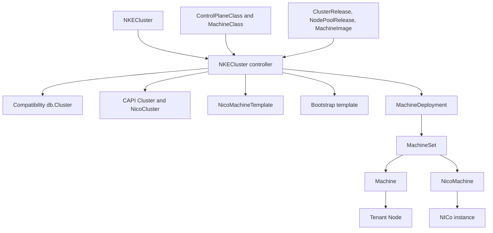
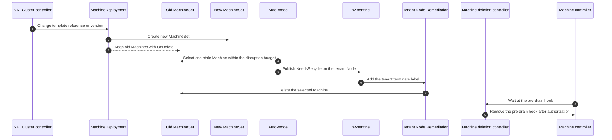

# NKE CAPI M3b: Worker MachineDeployments

Author: rbever

## Revision History

| Revision | Date | Notes |
|---|---|---|
| 1.0 | Oct 12, 2026 | Worker MachineDeployments rendered from `NKECluster`, with NKE rollout, disruption, and remediation behavior. Bootstrap credentials live in M3a |

## Related Designs

- [NKE CAPI M1: Infra provider abstraction](https://docs.google.com/document/d/1or0m1obQp6-YUdOr3bXZth64-gssxfsWFT-zFco31yE)
- [NKE CAPI M2: Migration path for Forge](https://docs.google.com/document/d/1svBFv6u7BpFN5TswoWyPc0jhfjIEnWmMYXBbF6Fn_GU)
- [Trey Thomas / spiffe-kubeadm-capi-poc](https://gitlab-master.nvidia.com/treyt/spiffe-kubeadm-capi-poc)
- [NKE CAPI M3b: Worker MachineDeployments](capi_m3_design_v1.4_b.md)
- [[DSX] NKE Workload Clusters SADD](https://docs.google.com/document/d/1dLI8IE3VE6Phy7PYh4fr7yXVc7Qw2mPElruxGsmnCb0/edit?tab=t.bq26oqijm5yh#heading=h.1u62c015ev8o)
- [NKE CAPI Worker Bootstrap Options and Decision](capi_m3_design_v1.4_a.md)
- [DSX NVKE Workload Cluster Node Provisioning and Bootstrap: Detailed Design](capi_m3_agentless_bootstrap_design.md)

## Overview

This design moves NKE worker nodes onto a CAPI-native lifecycle built from
`MachineDeployment`, `MachineSet`, `Machine`, a shared bootstrap template, and
a CAPI infrastructure provider.

The product contract is the management-engine API in
`internal.nke.nvidia.com/v1`. A tenant cluster is an `NKECluster`. Each worker
pool is an entry in `NKECluster.spec.nodePools`. Operator-owned
`MachineClass`, `ControlPlaneClass`, `MachineImage`, `ClusterRelease`, and
`NodePoolRelease` objects supply sizing, placement inputs, images, and
first-boot content. The NKECluster controller reads those objects and applies
one worker `MachineDeployment` per pool.

Which bootstrap provider renders that first-boot content is a separate
decision. [M3a](capi_m3_design_v1.4_a.md) records that decision. The chosen
join is the agent-less CABPK path, specified in
[DSX NVKE Workload Cluster Node Provisioning and Bootstrap: Detailed Design](capi_m3_agentless_bootstrap_design.md), with a DSX
IMDS identity source and an NVKE SPIRE identity source. This document only requires that a
worker generation reference one shared bootstrap template with no
node-specific join credential in it. That template is a
`KubeadmConfigTemplate`.

`InfraMachine` and `InfraMachineTemplate` are the conceptual names for
provider-specific infrastructure kinds. CAPNICo is the provider the controller
renders today, so those names are `NicoMachine` and `NicoMachineTemplate`.

The worker shape is:

- one `MachineDeployment` per `NKECluster.spec.nodePools` entry;
- CAPI-owned `MachineSet` generations under that deployment;
- CAPI-owned `Machine` and `NicoMachine` objects for individual workers;
- one shared bootstrap template per bootstrap generation;
- one shared `NicoMachineTemplate` per infrastructure generation;
- no worker `db.NodePool`, `db.NodeSet`, or `db.Node` rows; and
- no worker Temporal workflows.

Control-plane nodes stay on the existing NKE control-plane path. The same
controller projects an `NKECluster` into a compatibility `db.Cluster` so
`ProvisionCluster` can still create and join control-plane nodes. That record
is a control-plane bridge. It is not a worker source of truth.

The NKE behaviors this graph has to preserve are rollout pacing, scale-down
authorization, nv-sentinel disruption, remediation, unjoined-worker timeout,
and a REST view of the pool. CAPI owns replica count, MachineSet history, and
deletion mechanics. NKE decides when a joined GPU worker may be disrupted.

## Context

CAPI can already create NICo infrastructure behind `Cluster` and `Machine`
objects. Worker pools still do not use that model end to end on the legacy
path. NKE creates one worker `Machine` per Postgres `db.Node`, drives kubeadm
through Temporal and the node agent, and stores worker runtime state in
Postgres. NKE therefore owns scheduling, rollout, teardown, and history
behavior that CAPI already models for a homogeneous pool.

Workers fit `MachineDeployment`. They are interchangeable machines behind a
desired count. A template change should create a new generation without
immediately disrupting GPU workloads. Scale-up is CAPI's job. Scale-down,
recycle, and repair still have to respect NKE disruption policy and
nv-sentinel.

`NKECluster` is the desired-state object for that pool. Embedding node pools
on the cluster keeps worker count, machine class, placement, and node profile
in one spec. The controller renders CAPI directly from that spec.

## Goals and Non-Goals

Goals:

- Use one `MachineDeployment` per `NKECluster.spec.nodePools` entry.
- Keep worker runtime state in CAPI objects.
- Resolve worker images and first-boot content from `NodePoolRelease` and
  `MachineImage`.
- Resolve machine size and kubelet reservations from `MachineClass`.
- Reference one shared bootstrap template per worker generation. The template
  contract is in [M3a](capi_m3_design_v1.4_a.md). The join credential is
  specified in
  [DSX NVKE Workload Cluster Node Provisioning and Bootstrap: Detailed Design](capi_m3_agentless_bootstrap_design.md).
- Keep control-plane provisioning on the existing NKE path through a
  compatibility `db.Cluster`.
- Hold worker deletion at the pre-drain hook until disruption is authorized.
- Pace template rollouts with the pool's disruption budget instead of CAPI
  `RollingUpdate`.
- Project pool, generation, and node status onto the existing REST NodePool,
  NodeSet, and Node shapes.

Non-goals:

- Choose the worker bootstrap provider. That decision is recorded in M3a, and
  the chosen join is specified in the detailed design.
- Move control-plane nodes to CABPK or KubeadmControlPlane.
- Store MachineDeployment workers in `db.Node` or `db.NodeSet`.
- Drive MachineDeployment workers with Temporal workflows.
- Use CAPI `RollingUpdate` for GPU worker rollouts.
- Use CAPI `MachineHealthCheck` as the remediator.
- Design in-place mutation of already running workers.
- Select or execute a configuration profile for a MachineDeployment pool.
- Migrate existing REST or Postgres-backed worker pools.

## Current POC

The POC controller is `controller/internal/controllers/nkecluster`. It watches
`NKECluster` and server-side applies, in `nke-system`:

- a `NicoMachineTemplate`;
- a `KubeadmConfigTemplate`; and
- a `MachineDeployment` with `OnDelete`, oldest-MachineSet deletion order, and
  the NKE pre-drain hook on the machine template.

The local exercise input is
`controller/test/fixtures/nkecluster-poc/nkecluster.yaml`: cluster
`nico-containers-poc`, one worker pool, `replicas: 2`.

These NKE behaviors are implemented on that graph:

- a missing pool `MachineClass` or `NodePoolRelease` sets that pool's
  `Ready=False` and leaves its previous `MachineDeployment` in place;
- auto-mode marks one stale Machine per pass, limited by the pool's continuous
  disruption budget;
- tenant node remediation deletes or reboots the backing Machine from tenant
  Node signals, with no `db.NodePool` lookup;
- the Machine deletion controller holds the pre-drain hook until disruption is
  authorized;
- the provisioning monitor publishes a provisioning phase and deletes a
  Machine that never joins before the timeout;
- the Machine health controller reports node-agent and cordon state and does
  not replace the worker; and
- `GET /nodePools` and `GET /nodes` project the MachineDeployment, its current
  MachineSet, and its Machines into the existing REST shapes, including the
  pool wait message.

The management-engine `NKECluster` reconciler does not render workers. It owns
the cluster-level `Paused`, `Deleting`, `Synced`, `Available`, and `Ready`
conditions.

## API

All of these resources use `internal.nke.nvidia.com/v1`.

| Kind | Scope | Role |
|---|---|---|
| `NKECluster` | Namespace | Desired cluster: API access, network, release, control-plane class, and embedded worker pools |
| `ControlPlaneClass` | Cluster | Control-plane replica policy and provider machine template |
| `MachineClass` | Cluster | Provider instance type and kubelet memory reservations for a machine size |
| `MachineImage` | Cluster | Immutable image identity and NICo iPXE boot script |
| `ClusterRelease` | Cluster | Control-plane image reference and `machineInit` user-data template |
| `NodePoolRelease` | Cluster | Worker image reference and `machineInit` user-data template |

`NKECluster.spec` carries:

| Field | Use |
|---|---|
| `apiServerAccess` | Public access flag and source CIDRs. Not read by the NKECluster controller |
| `authentication` | Optional extra JWT issuers. Immutable after create. Not read by the NKECluster controller |
| `clusterNetwork` | Pod CIDRs, service CIDRs, and service domain. Copied onto the compatibility `db.Cluster` |
| `release.channel` | Control-plane release selection |
| `controlPlaneClass` | Name of a cluster-scoped `ControlPlaneClass` |
| `acceleratedRuntime` | Optional accelerated-runtime bundle, or `none`. Not read by the NKECluster controller |
| `network.vpcID` | Existing VPC shared by the node pools. Required when `nodePools` is non-empty |
| `nodePools` | Named worker pools. Omission requests a control plane with no workers |

Each embedded `NodePool` carries:

| Field | Use |
|---|---|
| `name` | Stable pool key and MachineDeployment name component |
| `machineClass` | `MachineClass` name. Exactly one of `machineClass` or `instanceType` |
| `instanceType` | Direct instance-type fallback while `MachineClass` is evaluated. Immutable |
| `replicas` | `MachineDeployment.spec.replicas`. Zero requests no workers |
| `vpcSubnetID` or `vpcPrefixID` | Exactly one NICo interface placement |
| `nodeProfile` | `<profile>:<tag>` selecting the worker release |
| `userParams` | Node labels and taints. Accepted by the API and not rendered yet |
| `rollout` | Disruption budgets. The strategy enum currently allows only `RollingUpdate` |

A pool changes size or kubelet reservations by selecting a new
`MachineClass` name. That reference change is an `NKECluster` update, so the
controller reconciles and produces a new infrastructure template. The
controller does not watch `MachineClass`. An in-place edit of a published
class is not a rollout, and one class can be named by many pools. The CRD
does not yet reject an in-place `MachineClass` spec edit. The intended
contract is still a new class name.

`ControlPlaneClass.spec` sets default replica count and max surge, selects a
`MachineClass`, lists ordered raw `NicoMachineTemplate` preferences, selects a
SPIRE attestation method (`tpm`, `joinToken`, or `dsxImds`), and can add
bootstrap files and `preKubeadmCommands`. Those inputs feed the compatibility
control-plane record, not the worker MachineDeployment.

`MachineImage.spec` is immutable. It records OS family and version,
architecture, optional variant, build date, and `nico.ipxeScript`.
`ClusterRelease` and `NodePoolRelease` reference one `MachineImage` and carry
an immutable `machineInit.userDataTemplate`. `lifecycle.deprecated` rejects new
references while existing clusters may keep using the release.

`NKECluster.status` defines `observedGeneration`, conditions, `resolvedRelease`,
and per-pool `replicas`, `readyReplicas`, `updatedReplicas`, and conditions.
The NKECluster controller writes each pool's `Ready` condition. It does not
write `resolvedRelease`, `ControlPlaneReady`, or the replica counts. A missing
pool `MachineClass` or `NodePoolRelease` sets that pool's `Ready=False` with
reason `WaitingForMachineClass` or `WaitingForNodePoolRelease`. Each pool
condition's `observedGeneration` identifies the NKECluster generation it
describes. The REST NodePool projection uses that condition for its
`Provisioning` message.

## Reconciliation

The NKECluster controller watches `NKECluster`. On each reconcile it:

1. Loads `ControlPlaneClass`, the control-plane `MachineClass` when named, and
   the `ClusterRelease` plus its `MachineImage`. A missing object requeues
   after one minute and does not apply pools.
2. Ensures a compatibility `db.Cluster` and applies the CAPI `Cluster`
   scaffold, including `NicoCluster`. If the compatibility cluster is not yet
   provisioned, reconcile enqueues `ProvisionCluster`.
3. For each `spec.nodePools` entry, in list order, loads `MachineClass` when
   named and the `NodePoolRelease` plus its `MachineImage`. A missing object
   sets that pool's `Ready=False` and requeues after one minute. That pool is
   not applied, so its previous `MachineDeployment` stays. Later pools in the
   list are not visited on that pass.
4. Server-side applies a `NicoMachineTemplate`, a bootstrap template, and a
   `MachineDeployment` in `nke-system`, then marks that pool `Ready=True` with
   reason `Ready` and message `Node pool is applied`.

Release lookup is direct. `spec.release.channel.name` is the `ClusterRelease`
name. `nodeProfile` uses the profile name before the colon as the
`NodePoolRelease` name and ignores the tag. Kubernetes version comes from the
release. When the release annotation says the version is injected, the
controller uses `spec.release.channel.version`.

The MachineDeployment name is `<cluster name>-<pool name>`. Template names are
that base plus 16 hex characters of the SHA-256 of the template spec, trimmed
to 63 characters. A spec change produces a new template name. A replica-only
change does not, so scale-up and scale-down stay on the current MachineSet.

Applied objects share these labels:

- `cluster.x-k8s.io/cluster-name`
- `internal.nke.nvidia.com/nkecluster-name`
- `internal.nke.nvidia.com/node-pool-name`

Those last two labels are how later controllers recognize a direct
`NKECluster` worker. There is no `nke.nvidia.com/node-pool-id` label and no
`db.NodePool` row. Where a controller or the REST API needs a pool ID, it
derives a UUID from `cluster name + "/" + pool name`.

The `NicoMachineTemplate` spec sets `vpcID` from `spec.network.vpcID`, one
interface from `vpcSubnetID` or `vpcPrefixID`, `instanceTypeID` from
`MachineClass.spec.nico` or from `instanceType`, the rendered iPXE script,
`cloudInitInjectHostname: true`, and the same labels. Disk selection is
currently the smallest disk.

The `MachineDeployment` sets:

| Field | Value |
|---|---|
| `spec.replicas` | `nodePools[].replicas` |
| `spec.deletion.order` | oldest MachineSet |
| `spec.rollout.strategy.type` | `OnDelete`, regardless of `rollout.strategy.type` |
| `spec.selector` | the shared labels above |
| `spec.template.spec.version` | the worker Kubernetes version |
| bootstrap ref | the generation's bootstrap template |
| infrastructure ref | the generation's `NicoMachineTemplate` |
| machine annotation | `pre-drain.delete.hook.machine.cluster.x-k8s.io/nke-disruption-authorization` |

CAPI owns `MachineSet`, `Machine`, the per-machine bootstrap object, and
`NicoMachine`. CAPNICo creates the NICo instance. After the instance exists,
the NICo provider-ID controller copies `NicoMachine.spec.providerID` onto the
tenant Node. Kubelet does not set that field, and CAPI needs it before
`Machine.status.nodeRef` can be set.

## Control Plane Boundary

Control-plane machines are not MachineDeployments.

The compatibility `db.Cluster` copies the cluster name, Calico as the CNI,
pod and service CIDRs, Kubernetes version, OIDC from controller config, and
control-plane desired count and max surge from `ControlPlaneClass`. The
control-plane provider payload copies the class's ordered
`NicoMachineTemplate` preferences, stamps `instanceTypeID` and the rendered
iPXE script from the control-plane `MachineClass` and `MachineImage`, and
appends class bootstrap files and `preKubeadmCommands` to the rendered
`ClusterRelease` machine init. SPIRE attestation method comes from the class.

`ProvisionCluster` still runs `kubeadm init` and
`kubeadm join --control-plane --certificate-key` through the node agent.
Worker pools do not enter that workflow.

`NicoCluster` is scaffolded with a fixed site ID and failure-domain label key.
Those values are placeholders until cluster placement is a real reference.

## Bootstrap Boundary

A worker generation has one shared bootstrap template. The template must not
contain a kubeadm bootstrap token, a per-node SPIFFE identity, or any other
join credential. Per-machine identity comes from the `Machine` after CAPI
creates it.

The worker generation uses a `KubeadmConfigTemplate`. The files, exec plugin,
discovery kubeconfig, identities, tenant authentication, and CSR approval are
specified in
[DSX NVKE Workload Cluster Node Provisioning and Bootstrap: Detailed Design](capi_m3_agentless_bootstrap_design.md). The
MachineDeployment name, `OnDelete` strategy, disruption hook, remediation, and
REST projection stay the same for both identity sources.

`userParams` labels and taints are not copied into node registration.

## Rollouts and Scale

Worker `MachineDeployment` uses `OnDelete`.

`RollingUpdate` would delete old GPU workers as soon as the template changes.
`OnDelete` creates a new `MachineSet` when the bootstrap template,
infrastructure template, or Kubernetes version changes, and leaves current
Machines running until something deletes them. The API field
`rollout.strategy.type` currently allows only `RollingUpdate`. The controller
does not copy that value. It always writes `OnDelete`. The field that the
controller does honor is `rollout.strategy.disruption`.

`OnDelete` does not cover replica scale-down. Lowering
`nodePools[].replicas` updates `MachineDeployment.spec.replicas` without a new
template name. CAPI then selects Machines for deletion, oldest MachineSet
first. Those deletions still stop at the pre-drain hook below.

A template change also does not delete the old workers. Auto-mode is what
turns a stale generation into an authorized recycle.

## Disruption Authorization

Every worker Machine carries:

`pre-drain.delete.hook.machine.cluster.x-k8s.io/nke-disruption-authorization`

`MachineDeletionController` watches Machines. For a MachineSet-owned worker
that is deleting and still has the hook, it removes the hook only after
authorization. Removing the hook lets the CAPI Machine controller drain and
delete. The controller requeues every 15 seconds while it waits.

`NODE_SIGNAL_DISRUPTION_AUTHORIZATION_ENABLED` defaults to enabled. When it is
disabled, deletion is authorized immediately and stock CAPI drain still runs.
In that mode, tenant node remediation also treats `NeedsRecycle=True` as
permission to delete the Machine.

When the gate is enabled, deletion is authorized if any of these is true:

- the Machine annotation `nke.nvidia.com/disruption-authorized` is set;
- the Machine has not joined;
- the CAPI Cluster is missing or deleting;
- the tenant Node is already gone; or
- the tenant Node has `nke.nvidia.com/terminate`.

A direct `NKECluster` worker has no `db.NodePool`, so this controller skips
the database node-pool checks when the Machine carries
`internal.nke.nvidia.com/nkecluster-name` and
`internal.nke.nvidia.com/node-pool-name`. While it waits, it sets
`nke.nvidia.com/NeedsRecycle` on the tenant Node and the same condition on the
Machine. That is the signal nv-sentinel and the remediation controller
observe.

The pool's continuous `rollout.strategy.disruption` budgets are the recycle
limit. Scheduled budgets are ignored. The smallest active count applies, and
percentages round up. Auto-mode reads that limit from `NKECluster`, not from a
`db.NodePool.recycleBudget`.

A Machine counts toward the available capacity when it has joined, CAPI
`NodeReady` and the tenant Node `Ready` condition are true, the Node is
schedulable, it does not need repair or recycle, and it is not deleting.
Auto-mode then allows `budget - max(desired - available, 0)` recycles, and
starts at most one. It selects the oldest Machine whose CAPI `UpToDate`
condition is false and publishes `NeedsRecycle` on that tenant Node. After it
marks one, it requeues after two minutes. A pass that marks nothing waits for
the next `NKECluster` or Machine event. nv-sentinel adds `nke.nvidia.com/terminate` when disruption
is allowed. Tenant node remediation deletes the Machine. The deletion
controller releases the pre-drain hook only after that authorization.

## Health, Remediation, and Provisioning

CAPI reports Machine readiness and rollout. NKE adds policy on top and does
not replace a joined worker just because it is unhealthy.

The Machine health controller reports, for a joined MachineDeployment worker:

- `NodeAgentReady`, from whether CWE can reach the node agent;
- `KubernetesUnschedulable`, from the tenant Node cordon; and
- `NeedsRecycle` and `NeedsRepair`, mirrored from the tenant Node conditions
  nv-sentinel writes.

It requeues about every two minutes. It does not delete the Machine.
`MachineHealthCheck` is not installed as the remediator. GPU worker health
stays separate from disruption. Authorization still goes through the pre-drain
hook, and CAPI performs the delete.

The tenant node remediation controller watches tenant Nodes. It reconciles
when the terminate label, reboot label, `NeedsRecycle` condition, or
machine-health annotation changes. It does not poll. A database resync of
about 15 minutes is only a recovery path.

A Machine with both `internal.nke.nvidia.com/nkecluster-name` and
`internal.nke.nvidia.com/node-pool-name` is remediated directly. There is no
`db.NodePool` lookup. For that worker:

- `nke.nvidia.com/terminate` deletes the backing Machine. If the Node also
  has a machine-health annotation, that value is copied onto the Machine
  first.
- When node-signal authorization is disabled, `NeedsRecycle=True` also deletes
  the Machine.
- `nke.nvidia.com/reboot` sets the Machine reboot annotation to the current
  time, removes the tenant reboot label, and records
  `CAPIRebootStarted`. That means the provider reboot was requested. It does
  not mean the node finished rebooting. Only providers that honor the
  annotation, such as NICo, reboot the instance.

A Machine that never sets `nodeRef` and exceeds `NODE_PROVISIONING_TIMEOUT`
(default 2 hours, `0` disables the timeout) is deleted so the
MachineDeployment can replace it. The provisioning monitor publishes
`nke.nvidia.com/Provisioning` on the Machine. The condition stays complete
after the tenant Node is ready. Later kubelet or agent failures do not move
it back to provisioning.

The monitor keys a direct worker by the same derived pool ID used in the REST
projection. Observed phases, in order, are:

- `WaitingForBootstrapData`
- `ProvisioningInfrastructure`
- `WaitingForSPIRERegistration`
- `WaitingForKubeadmAuthentication`
- `WaitingForKubeletCSRApproval` or `KubeletCSRDenied`
- `WaitingForKubeletCertificate`
- `WaitingForTenantNode`
- `WaitingForKubernetesNodeReady`
- provisioning complete

The phases after infrastructure readiness follow the current CABPK join path.
Their checkpoint rules are part of M3a Option A. The timeout behavior itself
is a MachineDeployment behavior: an unjoined Machine is deleted, and CAPI
creates a replacement to satisfy `spec.replicas`.

## Teardown

Deletion adds the finalizer `internal.nke.nvidia.com/nkecluster`. The
controller deletes labeled `MachineDeployment`, `KubeadmConfigTemplate`, and
`NicoMachineTemplate` objects, marks the compatibility `db.Cluster` deleting,
and enqueues `TeardownCluster`. It requeues every 10 seconds until those CAPI
objects and the database cluster are gone, then removes the finalizer.

Deleting the MachineDeployment is what starts worker teardown. Each Machine
still passes through the pre-drain hook unless an authorization rule above
releases it, including "the CAPI Cluster is deleting" and "the Machine has
not joined."

## Status and REST Projection

Two controllers write `NKECluster` status, and they own different conditions.

| Writer | Status |
|---|---|
| NKECluster controller | Per-pool `Ready`, including `WaitingForMachineClass` and `WaitingForNodePoolRelease` |
| Management-engine reconciler | Cluster-level `Paused`, `Deleting`, `Synced`, `Available`, `Ready`, and top-level `observedGeneration` |

The management-engine summaries are not a worker-health signal. The POC does
not write `ControlPlaneReady`, `resolvedRelease`, or
`status.nodePools[].replicas`. Replica progress is read from the
MachineDeployment.

`GET /nodePools` appends one REST NodePool per labeled MachineDeployment,
beside any Postgres pools:

| REST field | Source |
|---|---|
| NodePool ID | UUID derived from `cluster name + "/" + pool name` |
| Cluster ID | Compatibility `db.Cluster` ID |
| Name | `internal.nke.nvidia.com/node-pool-name` |
| Desired count | `MachineDeployment.spec.replicas` |
| Kubernetes version | `MachineDeployment.spec.template.spec.version` |
| Recycle budget | Smallest continuous disruption budget on the embedded pool |
| Current NodeSet ID | UID of the highest-revision MachineSet |
| `Provisioning` / `Provisioned` | MachineDeployment replica and Available conditions |

If the pool's `Ready` condition is `False` and its `observedGeneration`
matches the current `NKECluster` generation, that condition's message replaces
the provisioning message. That is how a missing class or release shows up in
forge-console before a MachineDeployment exists for the new spec. A pool that
has not been applied yet has no MachineDeployment, so it does not appear in
this list until the wait clears and the controller applies one.

`GET /nodes` projects each MachineSet-owned Machine:

| REST field | Source |
|---|---|
| Node ID | Machine UID |
| NodeSet ID | Owning MachineSet UID |
| NodePool ID | Same derived pool ID |
| Name | Machine name |
| IP | Machine internal IP |
| Provider instance | `nico://` provider ID prefix |
| Conditions | CAPI Machine conditions plus the provisioning condition |

Node labels from `userParams` are not present because they are not rendered
onto the Machine or the tenant Node.

## Controller Responsibilities

| Owner | Responsibility |
|---|---|
| NKECluster controller | Render `NKECluster` into the compatibility control-plane cluster and one MachineDeployment graph per worker pool. Write per-pool `Ready`. Own the `NKECluster` finalizer. |
| Management-engine NKECluster reconciler | Write cluster-level `Paused`, `Deleting`, `Synced`, `Available`, and `Ready`. |
| Stock CAPI controllers | Reconcile `MachineDeployment`, `MachineSet`, `Machine`, template refs, and node refs. |
| Bootstrap provider | Render the shared template and per-machine bootstrap data. Current POC: CABPK. See M3a. |
| CAPNICo | Create, reboot, and delete NICo instances from `NicoMachine`. |
| NICo provider-ID controller | Copy the NICo provider ID onto the tenant Node so CAPI can set `nodeRef`. |
| Auto-mode | Publish `NeedsRecycle` for one stale direct worker per pass, inside the continuous disruption budget. |
| Machine deletion controller | Hold the pre-drain hook until disruption is authorized, and publish `NeedsRecycle` while waiting. |
| Tenant node remediation | Delete or reboot the backing Machine when the tenant Node asks for it. |
| Machine health controller | Report node-agent reachability, cordon, and mirrored recycle or repair conditions. Do not delete the Machine. |
| Node provisioning monitor | Publish the provisioning phase and delete a Machine that never joins before the timeout. |
| REST projection | Present the MachineDeployment graph as NodePool, NodeSet, and Node. |
| `ProvisionCluster` | Create and join control-plane nodes for the compatibility `db.Cluster`. |

## Decisions

| Topic | Decision |
|---|---|
| Cluster API | `NKECluster` and its embedded `nodePools` are the desired worker and cluster spec. |
| Supporting API | `MachineClass`, `ControlPlaneClass`, `MachineImage`, `ClusterRelease`, and `NodePoolRelease` are cluster-scoped operator objects. |
| Machine class | Pools change size or kubelet reservations by selecting a new class name. The controller does not watch `MachineClass`. |
| Worker bootstrap | One shared template per generation. The provider and join credential are decided in M3a. The POC renders `KubeadmConfigTemplate`. |
| Worker orchestration | One `OnDelete` `MachineDeployment` per node pool. |
| Rollout pacing | Continuous disruption budgets limit auto-mode. CAPI `RollingUpdate` is not used. |
| Worker runtime state | CAPI objects only. No worker `db.Node`, `db.NodeSet`, or `db.NodePool`. |
| Worker identity | Labels `internal.nke.nvidia.com/nkecluster-name` and `internal.nke.nvidia.com/node-pool-name`. Pool ID is derived when a UUID is required. |
| Control plane | Compatibility `db.Cluster` and the existing `ProvisionCluster` workflow. |
| Deletion gate | One pre-drain hook, `nke-disruption-authorization`. |
| Remediation | Tenant Node signals delete or annotate the CAPI Machine. `MachineHealthCheck` is not used. |
| Unjoined timeout | Delete the Machine after `NODE_PROVISIONING_TIMEOUT` so the deployment replaces it. |
| REST compatibility | Project MachineDeployment, MachineSet, and Machine into the existing NodePool, NodeSet, and Node responses. |

## Open Questions

These are unresolved in the current types and reconciler.

**Placement.** `spec.network.vpcID` and per-pool `vpcSubnetID` or `vpcPrefixID`
are NICo placement fields on the tenant object. Control-plane placement is
still inside the raw `NicoMachineTemplate` on `ControlPlaneClass`, and
`NicoCluster` site identity is hardcoded. The shape under evaluation is a
provider placement reference, for example `NicoClusterPlacement`, that carries
the VPC and the control-plane and per-pool interfaces. `NKECluster` would keep
tenant intent and point at that object.

**Machine class.** `MachineClass` currently inlines `provider: nico` and
`nico.instanceTypeID`, and pools may still set `instanceType` instead. The
shape under evaluation is an NKE class that owns kubelet reservations and
references a provider class such as `NicoMachineClass` for `instanceTypeID`.
Pools would still change by selecting a new name. The CRD does not yet make
`MachineClass.spec` immutable.

**Release selection.** Channel promotion is not implemented.
`release.channel.name` is a `ClusterRelease` name, and `nodeProfile` ignores
the tag. The catalog has to define how a channel and a `<profile>:<tag>`
resolve to an exact release, including deprecated releases.

**Rollout strategy.** The API enum allows `RollingUpdate`, and the controller
always writes `OnDelete`. The enum should grow an `OnDelete` value, or the
field should be documented as unused, so the stored spec matches the
MachineDeployment.

**Rollout budgets.** Continuous disruption budgets limit how many stale
Machines auto-mode marks. Scheduled budgets are not evaluated.

**Node labels and taints.** `userParams` is valid on the pool and is not
rendered onto the Machine or the tenant Node.

**Authentication and access.** `authentication`, `apiServerAccess`, and
`acceleratedRuntime` are on `NKECluster` and are not consumed by the
NKECluster controller. Worker join authentication follows the bootstrap option
in M3a and the compatibility cluster's OIDC setting.

**Status.** The NKECluster controller writes per-pool `Ready`. Replica counts,
`resolvedRelease`, and `ControlPlaneReady` are unread. Pool progress is
visible on the projected REST NodePool and on the MachineDeployment.

**Control-plane lifecycle.** This design leaves control-plane joins on the
existing `ProvisionCluster` path. A later design has to choose whether control
plane stays there, moves to KubeadmControlPlane, or gets its own provider.
That choice is independent of the worker MachineDeployment graph.
