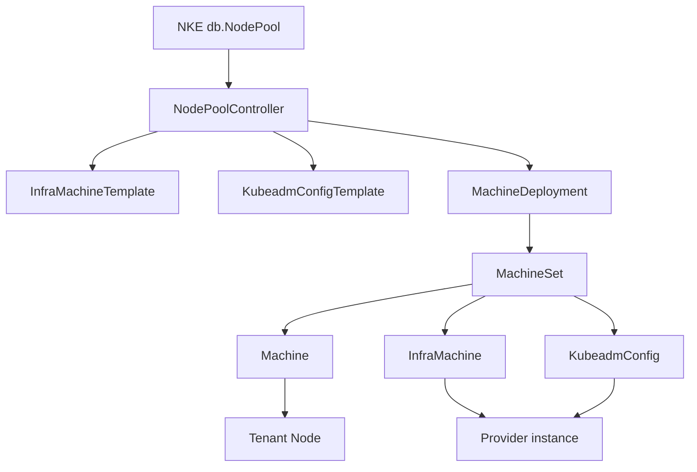
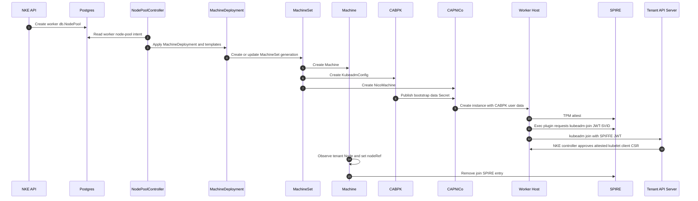
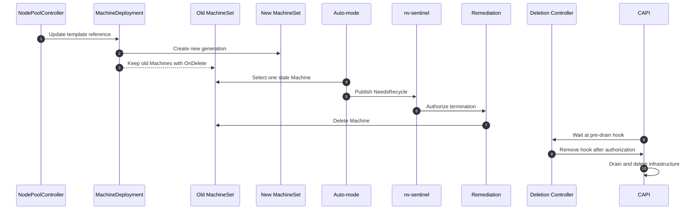

# CAPI M3 v1.3: Highlights

Author: rbever

Short version of the v1.3 worker MachineDeployment design. This summary assumes
stock CABPK. Bootstrap credential details stay in the separate bootstrap
design. The legacy worker path and fleet migration are also out of scope here.

## What Changes

NKE worker pools move from the Postgres and Temporal lifecycle to a CAPI-native
worker graph:

- one `MachineDeployment` per worker `db.NodePool`;
- CAPI-owned `MachineSet` generations;
- CAPI-owned `Machine` and provider `InfraMachine` objects;
- one shared `KubeadmConfigTemplate` and one shared
  `InfraMachineTemplate` per generation;
- no worker `db.NodeSet` or `db.Node` rows; and
- no worker Temporal workflows on the target path.

The NKE APIs remain the product-facing contract. `db.NodePool` continues to
store user intent, while runtime worker state moves to CAPI objects in the
management cluster.

Control-plane nodes do not move. They remain on the existing Postgres,
Temporal, and node-agent path.

## Object Graph

`NodePoolController` reads worker intent from `db.NodePool` and applies the
templates and `MachineDeployment`. CAPI owns the objects below that
deployment. Worker identity in the NKE compatibility APIs is the CAPI
`Machine` UID.

## Worker Join

Stock CABPK renders the worker join. The host mints its join credential after
attestation, and NKE approves the kubelet client CSR for the expected Machine.

## Template Generations

Infrastructure and bootstrap templates are immutable generations. Their names
include a short hash of the desired spec.

- A bootstrap, infrastructure, or Kubernetes-version change creates new
  template names.
- Updating the `MachineDeployment` template references creates a new
  `MachineSet`.
- A replica-only change updates `spec.replicas` without creating new
  templates.
- CAPI `UpToDate` conditions identify stale Machines.

This uses CAPI's normal generation model without allowing CAPI to decide when
an old GPU worker may be disrupted.

## Rollout and Scale-Down

Worker `MachineDeployment`s use `OnDelete`, not `RollingUpdate`.

`OnDelete` creates a new `MachineSet` after a template change but leaves old
Machines running. NKE auto-mode selects stale workers for recycle according to
the pool's disruption budget.

`OnDelete` does not protect replica scale-down. CAPI can still select a Machine
for deletion when replicas decrease. Every worker Machine therefore carries
one pre-drain lifecycle hook:

`pre-drain.delete.hook.machine.cluster.x-k8s.io/nke-disruption-authorization`

CAPI may select and begin deleting a Machine, but drain waits until the
Machine deletion controller sees authorization and removes the hook.

Authorization can come from:

- parent cluster or node-pool deletion;
- an nv-sentinel termination signal on the tenant Node;
- an explicit `DELETE /nodes/{id}` request; or
- the management-cluster
  `nke.nvidia.com/disruption-authorized` annotation.

When CAPI starts deletion, NKE publishes `NeedsRecycle=True` on the tenant Node
while waiting. That exposes the request to nv-sentinel and through the
compatibility API.

Sites without nv-sentinel may disable
`NODE_SIGNAL_DISRUPTION_AUTHORIZATION_ENABLED`. In that mode NKE removes its
hook promptly and stock CAPI drain still runs. A `NeedsRecycle=True` signal is
also sufficient to keep auto-mode rollouts moving.

The disruption-authorization pre-drain hook is the only deletion gate in this
design.

## Health and Remediation

NKE separates observing health from authorizing disruption.

The health controller reports NKE-owned Machine conditions for:

- node-agent reachability;
- Kubernetes readiness and schedulability;
- recycle need; and
- repair need.

A joined unhealthy worker is not replaced immediately. NKE or nv-sentinel must
first authorize disruption.

Auto-mode is signal-first for joined workers:

1. select one stale Machine within the disruption budget;
2. publish `NeedsRecycle=True` on its tenant Node;
3. wait for tenant policy to authorize termination;
4. delete the Machine; and
5. let CAPI drain it, remove infrastructure, and create replacement capacity.

Tenant remediation deletes or annotates the backing CAPI Machine. CAPI then
owns drain and infrastructure cleanup.

Reboot requests become provider reboot annotations. The compatibility status
`CAPIRebootStarted` means NKE accepted the asynchronous provider request; it
does not mean reboot completed.

The one direct replacement case is a worker that never joins. It cannot contain
a workload, so after the provisioning timeout NKE may delete it and let the
MachineDeployment replace it.

`MachineHealthCheck` is not used. Its generic unhealthy-means-replace contract
does not preserve NKE's workload-aware disruption and repair policy.

## Provisioning Status

MachineDeployment workers have no Temporal activity state. The provisioning
monitor instead derives a coarse NKE-owned Machine condition from CAPI:

- waiting for bootstrap data;
- provisioning infrastructure;
- waiting for the host to join;
- waiting for the tenant Node to become ready; or
- provisioning complete.

Provider and CAPI condition reasons and messages are retained where useful.
The monitor does not try to recreate Temporal's internal activity phases.

Provisioning completion is historical for an individual Machine. Once a
tenant Node becomes ready, later kubelet or node-agent failures do not move it
back into provisioning; those failures appear in separate health conditions.

At the NodePool level, `Provisioning` has broader convergence semantics. A
generation change, scale operation, rollout, or availability loss sets:

- `Provisioning=True`; and
- `Provisioned=False`

until the current generation and desired replica count are fully available.

## REST API Compatibility

The design keeps `/nodePools`, `/nodeSets`, and `/nodes`. It does not add a
public CAPI-native Machine API in this milestone.

- `/nodePools` remains backed by `db.NodePool`.
- `currentNodeSetID` projects the highest-revision `MachineSet` UID.
- `/nodeSets` projects `MachineSet`s into the existing node-set shape.
- `/nodes` projects MachineDeployment-owned `Machine`s into the existing
  node shape. Control-plane nodes still come from Postgres.
- Projected worker IDs are CAPI `Machine` UIDs.
- Get and delete fall back to Machine UID when no `db.Node` exists.

This preserves existing clients, but some UUID-shaped fields may not cleanly
represent Kubernetes UIDs. The exact compatibility identifier typing remains
open.

Each worker deployment is named:

`<cluster name>-<node pool name>`

`nodeNamePrefix` is removed for worker pools. Pool and cluster names must keep
the generated MachineSet, Machine, and Node name within Kubernetes' 63-character
limit.

## Configuration Profiles

`configProfile` is rejected for MachineDeployment worker pools.

- A MachineDeployment pool cannot select it.
- Existing control-plane behavior may continue using it.

Keeping profile execution would require another configuration object,
execution owner, bootstrap coordination, failure model, and rollout contract.
That is intentionally outside this worker lifecycle.

MachineDeployment workers also do not receive NKE's ordinary provisioning
taint. Optional configuration and taint management belong to a separate owner.

## Controller Ownership

- **Stock CAPI:** MachineDeployment, MachineSet, Machine, template references,
  replica count, node refs, drain, and infrastructure deletion.
- **NodePoolController:** render templates and the MachineDeployment from
  `db.NodePool`.
- **CABPK:** render the shared worker join and publish bootstrap data.
- **Health and auto-mode:** report health and request policy-authorized recycle.
- **Tenant remediation:** turn terminate, repair, and reboot signals into
  Machine deletes or provider annotations.
- **Machine deletion controller:** hold pre-drain until disruption is
  authorized.
- **Infrastructure provider:** create, reboot, and terminate provider
  instances.

## What Must Be True Before Shipping

- No worker Temporal workflow starts for a MachineDeployment pool.
- Scale-only changes do not create template generations.
- Template changes create a new MachineSet without automatically deleting old
  workers.
- Scale-down and recycle wait for disruption authorization.
- Never-joined Machines time out and are replaced.
- `/nodes`, `/nodeSets`, delete-by-Machine, and NodePool status continue to
  work.
- MachineDeployment workers have no `db.Node` or `db.NodeSet` rows.
- Distinct pool names produce distinct MachineDeployments.
- A joined worker receives a tenant Node, and its temporary join identity is
  removed after `nodeRef` is set.

## Main Questions for Review

- Can existing UUID-shaped Node and NodeSet fields safely carry Kubernetes
  Machine and MachineSet UIDs?
- Should `currentNodeSetID` remain once a pool is a MachineDeployment?
- Should NKE select the scale-down victim with
  `cluster.x-k8s.io/delete-machine`, or rely on MachineSet deletion ordering?
- How long should `/nodes` merge Postgres control-plane nodes with
  CAPI-backed workers?
- Does node-pool configuration history need a CAPI implementation, or is it
  unsupported for MachineDeployment pools?
- Is the broader NodePool meaning of `Provisioning` clear enough, or should a
  future API add a distinct `Reconciling` condition?
- What is the eventual first-class CAPI Machine API, after compatibility
  projection is no longer sufficient?
