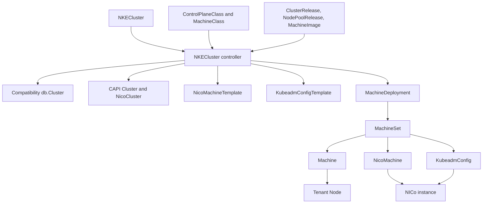
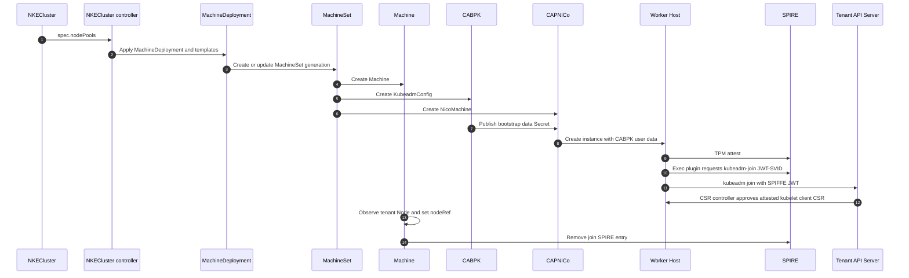
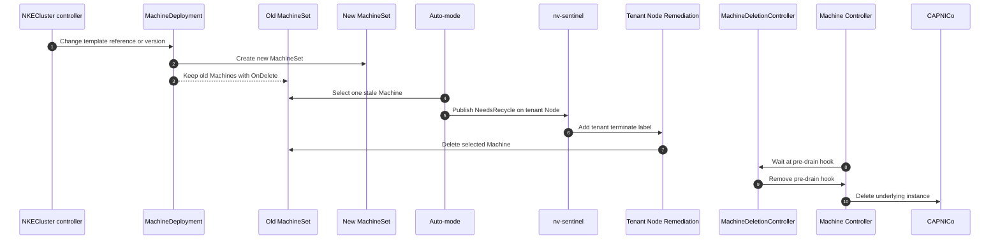

# CAPI M3 POC: Highlights

Author: rbever

Short version of the worker MachineDeployment design, focused on where the POC
uses the management-engine API and where it changed that API.

## What the POC Does

An `NKECluster` is the desired cluster. The NKECluster controller in the CWE
controller reads it and:

- projects a compatibility `db.Cluster` and keeps the existing
  `ProvisionCluster` workflow for the control plane;
- renders each `spec.nodePools` entry as one `OnDelete` `MachineDeployment`,
  with a `KubeadmConfigTemplate` and a `NicoMachineTemplate`;
- does not create worker `db.NodePool`, `db.NodeSet`, or `db.Node` rows, and
  does not run worker Temporal workflows.

Worker join is stock CABPK. Discovery is a kubeconfig whose credential is a
SPIFFE JWT-SVID minted on the host after TPM attestation. There is no kubeadm
bootstrap token in user data.

ℹ️ Note there is another POC in progress that may use an nke flavored bootstrap provider, but that doesn't really matter here

Deletion of a joined worker waits on nv-sentinel. The Machine template carries
one pre-drain hook. CAPI can select the Machine, but drain does not proceed
until the tenant Node has `nke.nvidia.com/terminate` (or an equivalent
authorization). Auto-mode only publishes `NeedsRecycle`.

This ran on Colossus nico-vms: a 3-node control plane came up through the
existing workflow, and a 1-replica MachineDeployment worker booted, joined, and
became Available.

The management-engine `NKECluster` reconciler is unchanged. It still only
summarizes conditions. The POC reconciler lives in the CWE controller and does
not write `NKECluster.status.nodePools`.

## What We Kept

These were already the management-engine contract. The POC consumes them and
does not redefine them.

| Kind | Role in the POC |
|---|---|
| `NKECluster` | Desired cluster, including embedded `spec.nodePools` |
| `NodePool` fields `name`, `replicas`, `nodeProfile`, `userParams`, `rollout` | Pool identity, count, image selection, labels and taints, disruption budgets |
| `MachineImage` | Immutable NICo iPXE script |
| `ClusterRelease` | Control-plane image and `machineInit` |
| `NodePoolRelease` | Worker image and `machineInit` |

`userParams` and `rollout` are accepted and not applied yet. The controller
always sets `OnDelete` and does not copy labels or taints into kubeadm.
`release.channel.name` is used as a `ClusterRelease` name. `nodeProfile` uses
the name before the colon and ignores the tag.

## What We Added, and Why

Two new CRDs, and two fields on the embedded node pool. All of them are marked
provisional in the types. They exist so the controller could render a NICo
machine, not because they are the proposed final API.

**`MachineClass`.** 
- Real NICo sizes need different kubelet memory reservations.
- That is not image content, so it does not belong on `MachineImage`.
- It is not a release-channel choice, so it does not belong on `ClusterRelease` or
`NodePoolRelease`. 
- The tenant pool should name a supported size rather than
carry raw reservations. 

The POC class therefore holds `nico.instanceTypeID`
plus `kubelet.systemReservedMemory` and `kubelet.kubeReservedMemory`. 

**`NodePool.machineClass`.** The pool names a `MachineClass` instead of an
instance type. The controller reads `instanceTypeID` and the kubelet
reservations from that class.

```yaml
apiVersion: internal.nke.nvidia.com/v1
kind: MachineClass
metadata:
  name: nico-vms-cpu4-mem6gb-disk60gb
spec:
  provider: nico
  nico:
    instanceTypeID: a1b2c3d4-0005-4000-8000-000000000003
  kubelet:
    systemReservedMemory: 1Gi
    kubeReservedMemory: 512Mi
---
apiVersion: internal.nke.nvidia.com/v1
kind: NKECluster
metadata:
  name: nico-vms-poc
  namespace: nke-system
spec:
  nodePools:
    - name: worker
      machineClass: nico-vms-cpu4-mem6gb-disk60gb
      replicas: 1
      vpcPrefixID: a1b2c3d4-0004-4000-8000-000000000001
      nodeProfile: nke-nico-vms-24.04-amd64-fde-live-poc:v1
```

The inline `provider: nico` block is a POC only shortcut. A more production-ready shape would likely use 
the same reference CAPI uses for `infrastructureRef`: an NKE `MachineClass`
owns the kubelet reservations, and `spec.infrastructure.classRef` points at a
provider class that owns `instanceTypeID`. Network placement stays on
`NKECluster`, not on the machine class. That keeps a second provider from
growing another inline block on the NKE type.

Maybe something like this:

```yaml
apiVersion: internal.nke.nvidia.com/v1
kind: MachineClass
metadata:
  name: cpu4-mem6gb
spec:
  kubelet:
    systemReservedMemory: 1Gi
    kubeReservedMemory: 512Mi
  infrastructure:
    classRef:
      apiGroup: infrastructure.cluster.x-k8s.io
      kind: NicoMachineClass
      name: nico-vms-cpu4-mem6gb-disk60gb
---
apiVersion: infrastructure.cluster.x-k8s.io/v1alpha1
kind: NicoMachineClass
metadata:
  name: nico-vms-cpu4-mem6gb-disk60gb
spec:
  instanceTypeID: a1b2c3d4-0005-4000-8000-000000000003
```

**`ControlPlaneClass`.** 
- `NKECluster.spec.controlPlaneClass` was already a
name with no body.
- The POC added a cluster-scoped object so control-plane replica count, max surge, SPIRE attestation method, and the ordered
`NicoMachineTemplate` preferences had somewhere to live.

The raw templates still embed `vpcID` and `vpcPrefixID`. That makes the class less reusable.
The type comment says this body is a placeholder.
This was simply to get the POC moving, not necessary a suggested API design.

```yaml
apiVersion: internal.nke.nvidia.com/v1
kind: ControlPlaneClass
metadata:
  name: capi-nico-poc
spec:
  replicas:
    default: 3
    maxSurge: 1
  machine:
    machineClass: nico-vms-cpu4-mem6gb-disk60gb
    spireAttestationMethod: tpm
    infrastructureTemplatePreferences:
      - apiVersion: infrastructure.cluster.x-k8s.io/v1alpha1
        kind: NicoMachineTemplate
        spec:
          template:
            spec:
              vpcID: a1b2c3d4-0002-4000-8000-000000000001
              interfaces:
                - vpcPrefixID: a1b2c3d4-0004-4000-8000-000000000001
              cloudInitInjectHostname: true
```


**`NodePool.vpcPrefixID`.** The POC added this field. Nico with new networking can no longer use a subnet ID, and requires a prefix ID.

```yaml
# Existing
nodePools:
  - name: worker
    vpcSubnetID: a1b2c3d4-0003-4000-8000-000000000001

# Added for nico-vms
nodePools:
  - name: worker
    vpcPrefixID: a1b2c3d4-0004-4000-8000-000000000001
```

That got the POC booting. It also made the placement problem obvious. `vpcID`,
`vpcSubnetID`, and `vpcPrefixID` are NICo attachment data on the tenant
object, next to the Kubernetes pod and service CIDRs. Worker placement is
those fields on `NKECluster`. Control-plane placement is the same IDs buried
in the raw `NicoMachineTemplate` inside `ControlPlaneClass`, shown above.
The two sides of one cluster do not describe placement the same way, and both
descriptions are NICo-specific.

The question is whether that attachment data should leave
`NKECluster` and `ControlPlaneClass` and sit on a provider object, for example
`NicoClusterPlacement`, that holds the VPC plus the control-plane and per-pool
interfaces. `NKECluster` would reference that object.

```yaml
apiVersion: internal.nke.nvidia.com/v1
kind: NicoClusterPlacement
metadata:
  name: nico-vms-poc
spec:
  vpcID: a1b2c3d4-0002-4000-8000-000000000001
  controlPlane:
    interfaces:
      - vpcPrefixID: a1b2c3d4-0004-4000-8000-000000000001
  nodePools:
    worker:
      interfaces:
        - vpcPrefixID: a1b2c3d4-0004-4000-8000-000000000001
---
apiVersion: internal.nke.nvidia.com/v1
kind: NKECluster
metadata:
  name: nico-vms-poc
  namespace: nke-system
spec:
  infrastructure:
    placementRef:
      apiGroup: internal.nke.nvidia.com
      kind: NicoClusterPlacement
      name: nico-vms-poc
  nodePools:
    - name: worker
      machineClass: nico-vms-cpu4-mem6gb-disk60gb
      replicas: 1
      nodeProfile: nke-nico-vms-24.04-amd64-fde-live-poc:v1
```

## Object Graph



## Worker Join



## Rollout and Node Deletion

`OnDelete` creates a new MachineSet when the template changes and leaves the
old workers running. Auto-mode marks one stale Node. nv-sentinel adds the
terminate label when disruption is allowed. Remediation deletes the Machine.
The pre-drain hook holds CAPI until that label is present.



## Questions for the API

- Should `MachineClass` become the published size contract, with kubelet
  reservations on the NKE class and `instanceTypeID` on the provider class?
- Should NICo VPC, subnet, and prefix move off `NKECluster` and `NodePool`
  onto a provider placement object?
- `ControlPlaneClass` was only a name. Is a reusable class the right owner for
  replica policy, or does that body belong next to placement?
- `rollout` budgets are the disruption policy the POC does not enforce yet.
  Who owns applying them on top of `OnDelete`?
